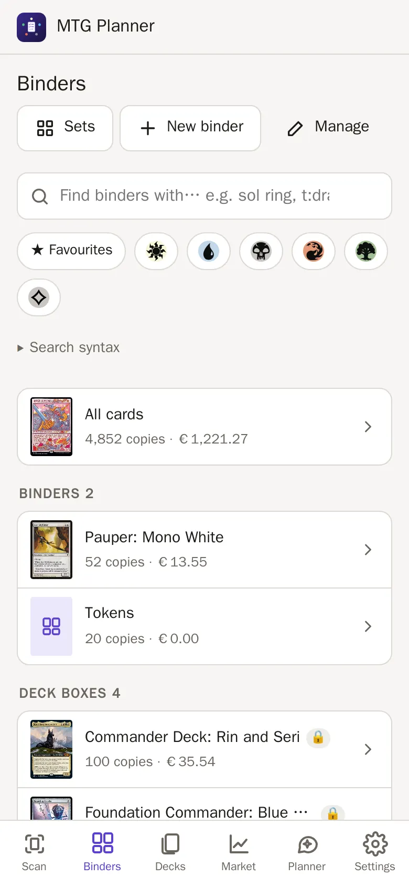
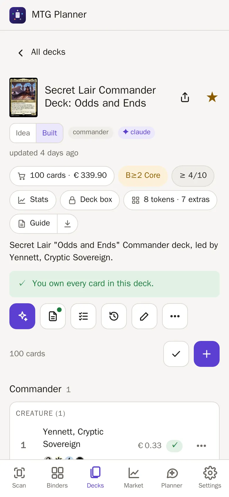
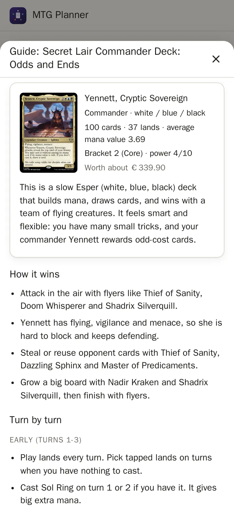

# mtg-planner

Your **Magic: The Gathering collection and deck planner**, running on your
own computer at home. See what you own, scan new cards with your phone, and
find out which cards a deck still needs.

**New here?** → [Installation guide](docs/install.md) (step by step) ·
[How to use it](docs/guide.md)

**Contents:** [What it does](#what-it-does) · [Quick start](#quick-start) ·
[Using it](#scan-cards) · [Good to know](#good-to-know) ·
[More details](#more-details) · [Credits](#credits) · [License](#license)

## What it does

- **Imports your collection** from the [ManaBox](https://manabox.app/) app.
- **Scans cards** with your phone's camera, one after another.
- **Sorts cards into binders**, right on your phone.
- **Plans decks** and shows what you own and what you still need to buy.
- **Shows prices** in euros and **tracks your collection's value** over time.
- **Lets you chat with Claude** about your cards and decks.
- **Makes backups** of everything with one tap.

Card data and prices come from [Scryfall](https://scryfall.com/).

  

## Quick start

New to Docker? Follow the step-by-step [Installation guide](docs/install.md).
You need an always-on Intel/AMD (amd64) computer with
[Docker](https://docs.docker.com/get-docker/). ARM (Raspberry Pi, Apple-chip
Macs) is not supported yet, sorry.

1. **Download the app:**

   ```bash
   git clone https://github.com/klopfer-hello/mtg-planner.git
   cd mtg-planner
   ```

   No git? On GitHub click **Code → Download ZIP**, unpack it and open a
   terminal in that folder.

2. **Create your settings file:**

   ```bash
   cp .env.example .env
   ```

3. **Optional: connect Claude** (only for the chat). Install
   [Claude Code](https://claude.com/claude-code) on any
   computer, log in with your Claude Pro or Max plan, and run
   `claude setup-token`. Copy the code it prints into `.env` after
   `CLAUDE_CODE_OAUTH_TOKEN=`. More: [docs/claude.md](docs/claude.md)

4. **Start it:**

   ```bash
   docker compose up -d
   ```

5. **Open it** in your browser: `http://localhost:8080` on the same
   computer.

**For the phone camera** you need a secure address (starting with
`https://`). Plain `http://` works for everything else. This is the trickiest
part: [how to do it](docs/install.md#7-make-the-phone-camera-work-https).

**Update later** (make a backup first, Settings → Backups):

```bash
docker compose pull
docker compose up -d
```

Your data stays. Changed `.env`? Run `docker compose up -d` again. **Stop:** `docker compose down`.

**On the first start** the app downloads card data. Cards printed since 2014
scan after a few minutes; older cards are recognised well after about two
hours (until then you may pick them by hand).

**There is no login.** Keep the app on your home network ([why](#good-to-know)).

## Scan cards


Open the **Scan** tab and tap **Start camera**.

- Put a card in view: on the table, in a box or in your hand.
- Hold it still. The app recognises it and adds it to your **scan list**.
- Second copy of the same card? Tap **+1**.
- Not recognised? Tap the **shutter** button.
- No camera? **From photo** scans pictures you already have.
- Done? Tap **Add all to…** and pick a binder or a deck.

Nothing goes into your collection until you tap **Add all to…**. Unsure
cards are marked **yellow**; if needed, the app asks you to pick.

More: [how to scan](docs/guide.md#2-scanning) · [docs/scanner.md](docs/scanner.md)

## Your collection

- **Import:** export a CSV in ManaBox, then upload it in **Settings**.
- **Sets** (Binders tab): how complete each set is. **Export** (Settings): a CSV for ManaBox or spreadsheets.
- **Search:** find cards with short codes. Example: `t:creature eur>2` =
  creatures worth more than €2. [All codes](docs/collection.md#search-syntax)
- **Binders:** the Binders tab starts with your binders (cover, copies,
  value), grouped by type. Tap one to open it. Move cards between them.
- **Edit or delete** copies from a card's details. Every change can be
  **undone** in Settings → Recent changes.
- **ManaBox or the app in charge?** ManaBox at first; the app asks once before it takes over. [Details](docs/collection.md#the-collection-master)

More: [docs/collection.md](docs/collection.md)

## Decks

- **Add a deck:** paste a list, or let Claude build one.
- Each card shows **owned**, **in another deck** or **to buy**, with prices.
- Mark a deck as **built** when it exists for real. Built decks reserve their
  cards, so you see conflicts between decks.
- **Market** tab: worth over time, top cards, price moves, a **wishlist** (♡ on any card) and **To buy** (what all your decks still need). [Details](docs/finance.md)
- **Build list** ticks off a deck's cards binder by binder; **Put into deck box** moves them into their own binder. **History** saves every deck change, so you can go back. **Tokens & extras** lists the tokens, counters and markers a deck needs.
- **Guide** writes a beginner's guide to a deck: how it wins, turn by turn, mulligans, key cards and the techniques it uses.
- Commander decks show a **bracket** (1-5) and a **power score** (1-10). Combos are checked at [Commander Spellbook](https://commanderspellbook.com/): only card names are sent, and you can turn it off. [Details](docs/decks.md#bracket-and-power-score)

More: [docs/decks.md](docs/decks.md)

## Ask Claude

The **Planner** tab is a chat with Claude, using your own Claude plan.

- Ask things like *"Build me a budget Atraxa deck from cards I own, max €40 to buy."*
- Claude checks your collection first and saves new decks as ideas.
- Claude can write a deck's **notes** (game plan, reminders) when you ask.
- Claude can fix a card's language, printing, foil or condition. It tells you the change first. It can **never delete** anything.

More: [docs/claude.md](docs/claude.md)

## Backups

Open **Settings → Backups**.

- **Create backup**, then **Download** it and keep it somewhere safe.
- **Restore** brings an older state back (your current data is saved first).
- Backups only happen when you tap. Nothing runs automatically.

More: [docs/backups-and-security.md](docs/backups-and-security.md)

## Good to know

- **There is no login.** Anyone who can open it can change your data and use your Claude plan. Keep it on your home network, never on the internet.
- Everything except the chat, deck guides and the Claude help for hard-to-scan cards works without Claude.
- **Share** a deck or binder: the arrow button sends a link to it.

## More details

| Topic | File |
| --- | --- |
| **Step-by-step install (beginners)** | [docs/install.md](docs/install.md) |
| **How to use the app** | [docs/guide.md](docs/guide.md) |
| Install, settings, HTTPS, nightly updates | [docs/setup.md](docs/setup.md) |
| Scanner: how it works, foil, calibration | [docs/scanner.md](docs/scanner.md) |
| Collection: imports, binders, editing, search | [docs/collection.md](docs/collection.md) |
| Decks, conflicts, to-buy lists | [docs/decks.md](docs/decks.md) |
| Market: value, wishlist, to buy | [docs/finance.md](docs/finance.md) |
| Claude chat and token | [docs/claude.md](docs/claude.md) |
| Backups and security | [docs/backups-and-security.md](docs/backups-and-security.md) |
| For developers: code, tests, releases | [docs/development.md](docs/development.md) |

## Credits

- Card data, images and prices: [Scryfall](https://scryfall.com/). Not made or endorsed by Scryfall.
- Magic: The Gathering, card names, card text and card images are © Wizards
  of the Coast LLC. mtg-planner is unofficial Fan Content and is **not
  affiliated with, endorsed, sponsored or approved by Wizards of the Coast**.
- Text reading uses [Tesseract](https://github.com/tesseract-ocr/tesseract).
  The chat uses the [Claude Code](https://claude.com/claude-code)
  program (downloaded on start, not included) and
  [scryfall-mcp](https://github.com/bmurdock/scryfall-mcp) for card lookups.
- [ManaBox](https://manabox.app/) is a separate app. This app only reads and writes its CSV files.

Full details: [docs/development.md](docs/development.md#third-party-data-and-software)
and [THIRD_PARTY_NOTICES.md](THIRD_PARTY_NOTICES.md).

## License

mtg-planner is **source-available** under the
[PolyForm Noncommercial License 1.0.0](LICENSE)
(SPDX `PolyForm-Noncommercial-1.0.0`). Copyright (c) 2026 Klopfer Hello.

- **Allowed:** use, change and share it for **non-commercial** purposes, for
  example your own collection, a hobby, or a non-profit or school. Keep the
  `Required Notice` line from the license file when you share it.
- **Not allowed:** any **commercial use**. For example: selling it, offering
  it as a paid service, or building it into a commercial product.
- Third-party parts (scryfall-mcp, Tesseract, libjpeg-turbo, Node.js, the
  Claude Code CLI, Scryfall data) keep their own licenses, see
  [THIRD_PARTY_NOTICES.md](THIRD_PARTY_NOTICES.md).
