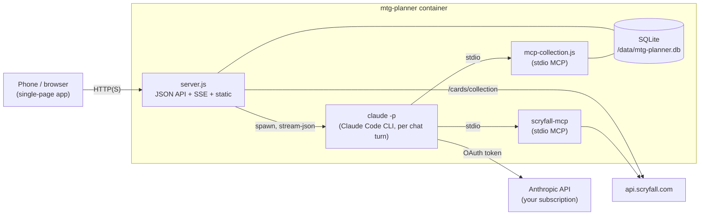

# mtg-planner

A self-hosted **Magic: The Gathering collection and deck planner** with a
Claude-powered deck-building assistant. You keep your collection in the
[ManaBox](https://manabox.app/) app, upload its CSV export from your phone's
browser, and then browse, search and plan decks against what you actually own.
Card data and prices come from [Scryfall](https://scryfall.com/).

One small Docker container. The web server and the collection tools are plain
Node.js with no npm dependencies, and data is stored in SQLite.

## Features

- **ManaBox sync from your phone.** Export your collection in ManaBox
  (CSV) and upload it in the web app. The default mode, *replace*, does a full
  sync: ManaBox is the source of truth. *Add* mode adds the uploaded counts on
  top of what is already there. Every printing is resolved against Scryfall,
  which also refreshes its price. ManaBox **deck binders** become decks
  automatically (a *replace* import also removes decks whose binder is gone),
  and **list binders** (wish lists) are skipped. A *replace* upload in which
  nothing can be resolved is refused, so the collection is never wiped by
  accident.
- **Collection browser** with Scryfall-style search syntax (`t:creature c<=bg
  cmc<=3 eur>2 -is:foil`, see [Search syntax](#search-syntax)). You can group by
  card or by printing and sort by name, mana value, price, quantity, set or
  rarity. Card details show every printing you own and every deck that uses
  the card.
- **Decks:** paste a list in MTGA, Moxfield or ManaBox format, or let Claude
  build one. Each card shows how many copies you own (counted across all
  printings) and how many are **missing**. The deck shows the
  **cost of the missing cards in EUR**, and copies are shared between main,
  side and maybe boards. Decks can be exported as a text list you can import
  elsewhere.
- **Claude planner:** a chat that runs the
  [Claude Code CLI](https://docs.anthropic.com/en/docs/claude-code) headless
  with exactly two MCP servers:
  - **collection**, this repo's own MCP server: it reads your collection and
    decks and can save new decks (`save_deck`). It cannot delete anything or
    change the collection.
  - **[bmurdock/scryfall-mcp](https://github.com/bmurdock/scryfall-mcp)** gives
    access to every card ever printed, prices, the comprehensive rules, staple
    and synergy searches, and deck and mana-base analysis.

  Ask things like *"Build me a budget Atraxa superfriends deck using mostly
  cards I own, max €40 to buy"*. Claude checks what you own first and saves the
  deck so it appears in the Decks tab. Conversations keep going across restarts
  (`--resume`).

## Quick start

```bash
git clone https://github.com/klopfer-hello/mtg-planner.git
cd mtg-planner
cp .env.example .env        # paste your CLAUDE_CODE_OAUTH_TOKEN (optional)
docker compose up -d        # pulls ghcr.io/klopfer-hello/mtg-planner:latest
```

Then open `http://<host>:8080` (change the host port with `MTG_PLANNER_PORT`).
Without compose:

```bash
docker run -d --name mtg-planner --restart unless-stopped \
  -p 8080:8080 \
  -e CLAUDE_CODE_OAUTH_TOKEN=... \
  -v mtg-planner-data:/data \
  -v mtg-planner-claude:/claude \
  ghcr.io/klopfer-hello/mtg-planner:latest
```

Host-specific additions such as a local build or reverse-proxy labels and
networks go into a gitignored `docker-compose.override.yml` (see
`docker-compose.override.yml.example`), so the committed compose file stays
generic.


Everything except the chat works without a Claude token.

## Configuration

Set these in `.env`, which `docker-compose.yml` loads if it exists:

| Variable | Default | Description |
| --- | --- | --- |
| `CLAUDE_CODE_OAUTH_TOKEN` | *(empty)* | Token for the Claude Code CLI from `claude setup-token`. Without it the chat is disabled and `/healthz` reports `claude_configured: false`. |
| `CLAUDE_MODEL` | *(CLI default)* | Optional `--model` for the planner, e.g. `sonnet` or `opus`. |
| `CLAUDE_MAX_CONCURRENT` | `2` | Maximum number of Claude CLI processes running at once (one per chat turn). |
| `CLAUDE_TIMEOUT_MS` | `600000` | Hard timeout for a single chat turn. |
| `MTG_PLANNER_PORT` | `8080` | Host port published by `docker-compose.yml`. Only used for compose interpolation. |
| `SCRYFALL_USER_AGENT` | `mtg-planner/1.0 (+repo url)` | User-Agent for the app's own Scryfall requests. |

These are set in the image and rarely need changing: `PORT=8080`,
`DB_FILE=/data/mtg-planner.db`, `STATIC_DIR=/app/public`,
`CLAUDE_CONFIG_DIR=/claude`,
`SCRYFALL_MCP_ENTRY=/opt/scryfall-mcp/dist/index.js` and `APP_VERSION`, which
is set at build time.

Volumes:

| Mount | Contents |
| --- | --- |
| `/data` | SQLite database (WAL mode) and the CLI's working directory |
| `/claude` | Claude Code config and chat sessions, so conversations can resume after a restart |

## Getting `CLAUDE_CODE_OAUTH_TOKEN`

On any machine where Claude Code is installed and logged in to your Claude
subscription (Pro or Max), run:

```bash
claude setup-token
```

and paste the printed token into `.env`. The planner then **uses your Claude
subscription's usage**, not API credits. Each chat turn starts one
`claude -p` process.

The planner has **no built-in Claude Code tools**: no shell, no file access
and no web. It is started with `--tools ""` and `--strict-mcp-config`, so it can
only use the two MCP servers listed above.

## Exporting from ManaBox

1. In ManaBox, open **Collection** and tap the **⋯** menu, then **Export**,
   then **CSV**. You can also export a single binder.
2. Save or share the file to your phone.
3. In mtg-planner, open **Import**, pick the file and choose **Replace (sync)**,
   the default, or **Add**.

The import needs the `Name` column plus either `Scryfall ID` or `Set code`.
It also understands `Collector number`, `Foil`, `Quantity`, `Condition`,
`Language`, `Purchase price`, `Purchase price currency`, `Binder Name` and
`Binder Type`. Comma and semicolon delimiters both work, and a UTF-8 BOM is
fine.

Each import also refreshes prices. To refresh card data and prices without
importing, call `POST /api/refresh-prices`. It re-fetches everything you own or
use in a deck.

## Search syntax

The collection browser and Claude's `search_collection` tool use the same
query language. Terms are combined with AND, a leading `-` negates a term, and
values with spaces go in quotes.

| Query | Meaning |
| --- | --- |
| `bolt`, `n:"sol ring"` | name contains |
| `t:creature`, `t:legendary` | type line contains |
| `o:"draw a card"` | oracle text contains |
| `k:flying` | has keyword |
| `c:wu` | colors include white **and** blue |
| `c=wu`, `c!=wu` | exactly / not exactly white-blue |
| `c<=wu` | only white and/or blue (or colorless) |
| `c<wu`, `c>u` | strict subset / superset |
| `c:m`, `c:c` | multicolor / colorless; `c:red`, guild and shard names (`c:azorius`, `id:esper`) also work |
| `id:bg` | color identity within black-green (commander deck building) |
| `cmc<=3`, `mv=2` | mana value (`= < > <= >= !=`) |
| `r:mythic`, `r:u` | rarity (`common`, `uncommon`, `rare`, `mythic`, `special`, `bonus`) |
| `s:mh3` | set code |
| `f:commander` | legal (or restricted) in format |
| `is:foil`, `is:nonfoil`, `is:etched` | owned finish |
| `is:commander` | legendary creature or "can be your commander" |
| `eur>5`, `usd<1` | price of the owned finish (foil/etched prices for foil/etched copies) |
| `qty>=4` | total owned copies (summed over the grouped rows) |
| `b:"trade binder"` | ManaBox binder name contains |
| `lang:de` | card language |
| `-t:land` | negation of any term |

Unknown keys return an error that lists the supported syntax.

## Architecture



- `server.js`: HTTP API, ManaBox import, decks, and chat over Server-Sent
  Events. It uses the Node standard library only.
- `lib/db.js`: SQLite schema (`cards`, `collection`, `decks`, `deck_cards`,
  `imports`, `chats`, `messages`) on `node:sqlite`, plus price helpers.
- `lib/scryfall.js`: rate-limited Scryfall client and card normalisation.
- `lib/query.js`: compiles the search syntax to SQL.
- `lib/manabox.js`: CSV parser and ManaBox import (replace/add, binders).
- `lib/decks.js`: decklist parsing, name resolution (owned printings first),
  and ownership and missing-cost math.
- `lib/claude.js`: spawns the CLI per turn and turns `stream-json` into UI
  events.
- `mcp-collection.js`: hand-rolled MCP stdio server (JSON-RPC 2.0) with the
  tools `collection_overview`, `search_collection`, `check_owned`, `get_card`,
  `list_decks`, `get_deck` and `save_deck`.
- `public/`: the single-page web app.

The web server and the MCP server open the same database file, which runs in
WAL mode with a busy timeout.

## Security

**There is no authentication.** Anyone who can reach the app can read your
collection, import over it, edit and delete decks, and **use your Claude
subscription** through the chat. Run it only on a trusted LAN, or behind a
reverse proxy that handles authentication (for example Authelia, oauth2-proxy
or basic auth in Caddy/nginx). Don't expose it to the internet as it is.

State-changing API requests that a browser marks as cross-site (via
`Sec-Fetch-Site` or an `Origin` that doesn't match the `Host`) are refused,
and the API requires `application/json` / `text/csv` bodies, so other web pages
open in a LAN browser can't trigger imports or deck changes. This is not a
substitute for authentication.

The Claude CLI runs without built-in tools or slash commands, but its two MCP
servers can reach the internet (Scryfall) and write decks.

## Development

Node.js ≥ 24 is required for the built-in `node:sqlite`. There are no
dependencies to install.

```bash
# local build instead of the GHCR image
cp docker-compose.override.yml.example docker-compose.override.yml
scripts/deploy.sh      # VERSION=<semver>+<sha>, docker compose up -d --build, waits for healthy

# tests (node:test, offline: Scryfall is stubbed)
npm test
# ...or without a local Node:
docker run --rm -v "$PWD":/app -w /app node:24-slim npm test
```

Releases: push a `vX.Y.Z` tag. GitHub Actions builds and pushes
`ghcr.io/klopfer-hello/mtg-planner:latest` and `:vX.Y.Z` with
`VERSION=X.Y.Z+<12-char sha>`, then creates a GitHub release whose changelog is
grouped by Conventional Commit type.

Pinned build inputs, as Dockerfile `ARG`s:
`CLAUDE_CODE_VERSION=2.1.296` and
`SCRYFALL_MCP_REF=dc06a9749d7554564ddaa0f7f17305124b074968`.

## Credits

- Card data, images and prices come from [Scryfall](https://scryfall.com/) and
  are used under the
  [Scryfall API guidelines](https://scryfall.com/docs/api). This project is
  not produced by or endorsed by Scryfall.
- Magic: The Gathering, card names, card text and card images are © Wizards of
  the Coast LLC. mtg-planner is unofficial Fan Content and is **not affiliated
  with, endorsed, sponsored or approved by Wizards of the Coast**.
- [bmurdock/scryfall-mcp](https://github.com/bmurdock/scryfall-mcp) (MIT) is
  the Scryfall MCP server bundled in the image.
- [ManaBox](https://manabox.app/) is a third-party app. mtg-planner only reads
  its CSV exports.

## License

[MIT](LICENSE) © 2026 Klopfer Hello
