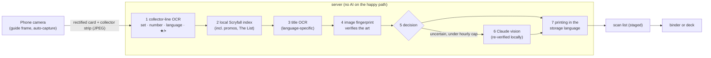
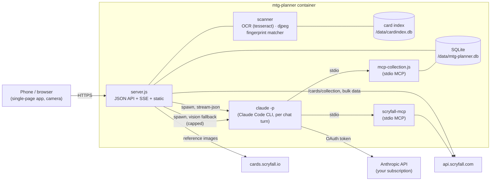

# mtg-planner

A self-hosted **Magic: The Gathering collection and deck planner** with a
Claude-powered deck-building assistant. You keep your collection in the
[ManaBox](https://manabox.app/) app, upload its CSV export from your phone's
browser, and then browse, search and plan decks against what you actually own.
You can also **scan cards with your phone's camera**: a ManaBox-style scanner
identifies each card locally and stages it for review before it goes into a
binder or a deck. Card data and prices come from [Scryfall](https://scryfall.com/).

One Docker container. The web server and the collection tools are plain
Node.js with no npm dependencies, and data is stored in SQLite. The scanner
uses two system tools from Debian inside the image (tesseract OCR and `djpeg`).

## Features

- **ManaBox sync from your phone.** Export your collection in ManaBox
  (CSV) and upload it in the web app. The default mode, *replace*, does a full
  sync: ManaBox is the source of truth. Once you organise ManaBox cards into
  binders in the app, mtg-planner becomes the master and imports default to
  *delta*: only the copies that are new since the last ManaBox export are added,
  fewer copies are reported but never deleted, and the same file imported twice
  changes nothing (see [Binders](#binders-and-the-collection-master)). *Add*
  mode adds every copy in the file again. Every printing is resolved against Scryfall,
  which also refreshes its price. ManaBox **deck binders** become decks
  automatically (a *replace* import also removes decks whose binder is gone),
  and **list binders** (wish lists) are skipped. A *replace* upload in which
  nothing can be resolved is refused, so the collection is never wiped by
  accident.
- **Camera scanner** (see [Scanner](#scanner)). Point the phone at a card
  and it is captured once it is steady and sharp, then identified on the server
  from a local Scryfall index. The reads are the collector line (OCR), the
  title (OCR) and an image fingerprint. Claude vision is an optional fallback
  for uncertain cards and is capped per hour. Scans land in a **scan list**,
  where you fix printing, finish, quantity and condition. You then add them to
  a **binder** or a **deck**, either an existing one or a new one.
- **Collection browser** with Scryfall-style search syntax (`t:creature c<=bg
  cmc<=3 eur>2 -is:foil`, see [Search syntax](#search-syntax)). You can group by
  card or by printing and sort by name, mana value, price, quantity, set or
  rarity. Card details show every printing you own and every deck that uses
  the card.
- **Binders on the phone:** create, rename, merge and delete binders, filter
  the collection by binder (or *Unsorted*), move single copies from a card's
  details, or select many cards and move them in bulk.
- **Decks:** paste a list in MTGA, Moxfield or ManaBox format, or let Claude
  build one. Each card shows how many copies you own (counted across all
  printings) and how many are **missing**. The deck shows its **value in EUR**
  (owned, to buy, maybeboard) and the **cost of the missing cards**, and
  copies are shared between main, side and maybe boards. You can set the
  **commander** (up to two for partner/background pairs; legendary creatures in
  the deck are suggested) and move cards between boards. Decks can be exported
  as a text list you can import elsewhere.
- **Idea vs. built decks:** a deck is an *idea* (a plan) or *built* (a physical
  deck; decks synced from ManaBox deck binders start as built). Built decks
  **claim** their copies (commander, main and side boards; basic lands never
  count), so every deck and card shows *owned* and *free* copies. Two built
  decks that need more copies than you own are flagged as a **conflict**. A
  **shopping list** shows what each deck still needs and, across all built
  decks, what to buy with a € total. **Put into deck box** moves the copies a
  built deck needs into a `Deck box: <name>` binder (Unsorted first, never out
  of another built deck's box; the box is remembered, also when the deck or
  the binder is renamed, and a ManaBox deck's own binder already counts as
  boxed).
- **Claude planner:** a chat that runs the
  [Claude Code CLI](https://docs.anthropic.com/en/docs/claude-code) headless
  with exactly two MCP servers:
  - **collection**, this repo's own MCP server: it reads your collection and
    decks and can save new decks (`save_deck`). It cannot delete anything or
    change the collection.
  - **[bmurdock/scryfall-mcp](https://github.com/bmurdock/scryfall-mcp)** gives
    access to every card ever printed, prices, the comprehensive rules, staple
    and synergy searches, and deck and mana-base analysis.

  Ask things like *"Build me a budget Atraxa superfriends deck using mostly
  cards I own, max €40 to buy"*. Claude checks what you own first and saves the
  deck so it appears in the Decks tab as an *idea*. Ask it to build *"only from
  free cards"* and it leaves the copies your built decks use alone. Answers are kept short for a phone
  screen: the answer first, a few bullets, and a deck summary instead of the
  full list (ask for details when you want them). Conversations keep going
  across restarts (`--resume`).

## Quick start

```bash
git clone https://github.com/klopfer-hello/mtg-planner.git
cd mtg-planner
cp .env.example .env        # paste your CLAUDE_CODE_OAUTH_TOKEN (optional)
docker compose up -d        # pulls ghcr.io/klopfer-hello/mtg-planner:latest
```

Then open `http://<host>:8080` (change the host port with `MTG_PLANNER_PORT`).
Without compose:

```bash
docker run -d --name mtg-planner --restart unless-stopped \
  -p 8080:8080 \
  -e CLAUDE_CODE_OAUTH_TOKEN=... \
  -v mtg-planner-data:/data \
  -v mtg-planner-claude:/claude \
  ghcr.io/klopfer-hello/mtg-planner:latest
```

On the first start the container downloads the Claude Code CLI into the
`/claude` volume (see [Claude Code CLI](#claude-code-cli-installed-at-runtime)),
which needs access to `registry.npmjs.org` once.

Host-specific additions such as a local build or reverse-proxy labels and
networks go into a gitignored `docker-compose.override.yml` (see
`docker-compose.override.yml.example`), so the committed compose file stays
generic.


Everything except the chat and the scanner's Claude fallback works without a
Claude token. The camera scanner needs HTTPS (see
[Phones, HTTPS and capture](#phones-https-and-capture)).

## Configuration

Set these in `.env`, which `docker-compose.yml` loads if it exists:

| Variable | Default | Description |
| --- | --- | --- |
| `CLAUDE_CODE_OAUTH_TOKEN` | *(empty)* | Token for the Claude Code CLI from `claude setup-token`. Without it the chat is disabled and `/healthz` reports `claude_configured: false`. |
| `CLAUDE_CODE_VERSION` | *(pinned in the image, 2.1.296)* | Claude Code CLI version the entrypoint installs into `/claude/cli`. Changing it installs that version on the next start. |
| `CLAUDE_CLI_INSTALL` | `true` | `false` skips the runtime install (bring your own CLI via `CLAUDE_BIN`, or run without the chat). |
| `CLAUDE_MODEL` | *(CLI default)* | Optional `--model` for the planner, e.g. `sonnet` or `opus`. |
| `CLAUDE_MAX_CONCURRENT` | `2` | Maximum number of Claude CLI processes running at once (one per chat turn). |
| `CLAUDE_TIMEOUT_MS` | `600000` | Hard timeout for a single chat turn. |
| `MTG_PLANNER_PORT` | `8080` | Host port published by `docker-compose.yml`. Only used for compose interpolation. |
| `SCRYFALL_USER_AGENT` | `mtg-planner/1.0 (+repo url)` | User-Agent for the app's own Scryfall requests. |
| `SCAN_CLAUDE_PER_HOUR` | `60` | Maximum Claude vision calls per hour for uncertain scans. `0` disables the Claude fallback. |
| `CLAUDE_SCAN_MODEL` | `sonnet` | Model for the scanner's vision fallback. |
| `SCAN_THRESHOLDS` | *(empty)* | JSON object that overrides single decision thresholds (see [Calibration mode](#calibration-mode)). |
| `SCAN_AUTO_INDEX` | `true` | Build the card index and then the fingerprints automatically when the index is empty. |
| `FP_KEEP_IMAGES` | `true` | Keep downloaded reference images under `FP_IMAGE_DIR` (about 1.2 GB) for cheap re-hashing. |
| `FP_INDEX_SETS` | *(empty)* | Comma-separated set codes that limit the fingerprint job (for testing). Empty means all sets. |
| `INDEX_BULK_SOURCE` | *(empty)* | Local path (or URL) of a Scryfall `all_cards` .jsonl.gz to build the index from instead of downloading it. Empty means download. |
| `SCAN_DUPLICATE_WINDOW_MS` | `20000` | The same printing and finish scanned again within this window is offered as +1 instead of being staged. |
| `SCAN_MAX_CONCURRENT` | `2` | Scans identified at the same time; further uploads get HTTP 429 ("still identifying") until one finishes. |
| `CLAUDE_SCAN_MAX_BUDGET_USD` | `0.25` | Spend cap per Claude vision call (`--max-budget-usd`). |
| `CLAUDE_SCAN_TIMEOUT_MS` | `90000` | Timeout for one Claude vision call. |
| `OCR_TIMEOUT_MS` | `20000` | Timeout for one tesseract/djpeg run. |
| `OCR_MAX_CONCURRENT` | `2` | tesseract processes running at once. |
| `SCHEDULER_ENABLED` | `true` | Nightly maintenance (see [Index and price refresh](#index-and-price-refresh)). `false` turns it off. |
| `INDEX_REFRESH_HOUR` | `4` | Hour of day (0-23, container local time) of the maintenance window. |
| `INDEX_REFRESH_DAYS` | `7` | Minimum age of the card index before it is refreshed (only when Scryfall has newer bulk data). |
| `PRICE_REFRESH_DAYS` | `7` | Minimum age of the last price refresh of owned and deck cards. |
| `TZ` | *(UTC)* | Container time zone (IANA name, e.g. `Europe/Berlin`), used for `INDEX_REFRESH_HOUR`. |
| `SCAN_IMAGE_DIR` | `<database dir>/scans` | Where uploaded scan photos are kept until they are committed (calibration scans keep them). |

These are set in the image and rarely need changing: `PORT=8080`,
`DB_FILE=/data/mtg-planner.db`, `STATIC_DIR=/app/public`,
`CLAUDE_CONFIG_DIR=/claude`,
`SCRYFALL_MCP_ENTRY=/opt/scryfall-mcp/dist/index.js`,
`INDEX_DB_FILE=/data/cardindex.db`, `FP_IMAGE_DIR=/data/images`,
`OMP_THREAD_LIMIT=1` (keeps tesseract to one thread per process) and
`APP_VERSION`, which is set at build time.

Volumes:

| Mount | Contents |
| --- | --- |
| `/data` | SQLite database (WAL mode), the scanner's card index (`cardindex.db`), reference images (`images/`, ~1.2 GB), stored scan photos, and the CLI's working directory |
| `/claude` | Claude Code config and chat sessions, so conversations can resume after a restart, plus the runtime-installed CLI in `/claude/cli` (about 250 MB) |

## Getting `CLAUDE_CODE_OAUTH_TOKEN`

On any machine where Claude Code is installed and logged in to your Claude
subscription (Pro or Max), run:

```bash
claude setup-token
```

and paste the printed token into `.env`. The planner then **uses your Claude
subscription's usage**, not API credits. Each chat turn starts one
`claude -p` process.

The planner has **no built-in Claude Code tools**: no shell, no file access
and no web. It is started with `--tools ""` and `--strict-mcp-config`, so it can
only use the two MCP servers listed above.

## Claude Code CLI (installed at runtime)

The Claude Code CLI is proprietary software of Anthropic and is **not part of
this repository or the published image**. The image's entrypoint
(`scripts/entrypoint.sh`) installs the pinned version on start:

```
npm install -g --prefix /claude/cli @anthropic-ai/claude-code@$CLAUDE_CODE_VERSION
```

It runs only when `/claude/cli` is missing or holds a different version, so it
downloads once per volume and version; later starts skip it. The install goes
into a temporary directory first, so a failed upgrade keeps the working
version. If the install fails (for example without network access), the app
still starts: the chat and the scanner's Claude fallback report that the CLI
is not installed, and `/healthz` shows
`claude_cli: {status: "missing", ...}` (`"installed"` with the version once it
works). Restart the container to retry. You use the CLI under
[Anthropic's terms](https://www.anthropic.com/legal/consumer-terms) with your
own subscription.

## Exporting from ManaBox

1. In ManaBox, open **Collection** and tap the **⋯** menu, then **Export**,
   then **CSV**. You can also export a single binder.
2. Save or share the file to your phone.
3. In mtg-planner, open **Import**, pick the file and choose a mode. The
   default follows the [collection master](#binders-and-the-collection-master):
   *Replace (sync)* while ManaBox is the master, *Only new copies (delta)* once
   mtg-planner is. *Add everything* adds every copy in the file again.

The app remembers the last ManaBox export (every import rewrites that
snapshot). A *delta* import compares the file with it per printing, finish,
language, condition and binder: increases are added into their ManaBox binder,
decreases are listed as "ManaBox has fewer copies of X (−n)" and nothing is
deleted.

The import needs the `Name` column plus either `Scryfall ID` or `Set code`.
It also understands `Collector number`, `Foil`, `Quantity`, `Condition`,
`Language`, `Purchase price`, `Purchase price currency`, `Binder Name` and
`Binder Type`. Comma and semicolon delimiters both work, and a UTF-8 BOM is
fine.

Each import also refreshes prices. To refresh card data and prices without
importing, call `POST /api/refresh-prices`. It re-fetches everything you own or
use in a deck.

### Index and price refresh

A built-in scheduler keeps data fresh without any clicks. It checks every 15
minutes and acts only inside the hour `INDEX_REFRESH_HOUR` (default 4 o'clock,
container local time, so set `TZ`). It runs one job at a time:

- the scanner's **card index** is refreshed when it is older than
  `INDEX_REFRESH_DAYS` (default 7) **and** Scryfall's bulk data is newer than
  the local copy (one small request to Scryfall's bulk-data list), followed by
  the incremental fingerprint job, which skips already-hashed cards;
- the **prices** of owned and deck cards are refreshed when the last refresh is
  older than `PRICE_REFRESH_DAYS` (default 7), within Scryfall's rate limits.

It runs at most once per night: later checks in the same hour, and restarts
inside it, skip once the run is done (a failed price refresh is retried within
the hour). A container started inside that hour checks a minute after start.

The last and next runs are shown in the index panel of the Import tab and in
`GET /api/index/status`. `SCHEDULER_ENABLED=false` turns it off.

## Search syntax

The collection browser and Claude's `search_collection` tool use the same
query language. Terms are combined with AND, a leading `-` negates a term, and
values with spaces go in quotes.

| Query | Meaning |
| --- | --- |
| `bolt`, `n:"sol ring"` | name contains |
| `t:creature`, `t:legendary` | type line contains |
| `o:"draw a card"` | oracle text contains |
| `k:flying` | has keyword |
| `c:wu` | colors include white **and** blue |
| `c=wu`, `c!=wu` | exactly / not exactly white-blue |
| `c<=wu` | only white and/or blue (or colorless) |
| `c<wu`, `c>u` | strict subset / superset |
| `c:m`, `c:c` | multicolor / colorless; `c:red`, guild and shard names (`c:azorius`, `id:esper`) also work |
| `id:bg` | color identity within black-green (commander deck building) |
| `cmc<=3`, `mv=2` | mana value (`= < > <= >= !=`) |
| `r:mythic`, `r:u` | rarity (`common`, `uncommon`, `rare`, `mythic`, `special`, `bonus`) |
| `s:mh3` | set code |
| `f:commander` | legal (or restricted) in format |
| `is:foil`, `is:nonfoil`, `is:etched` | owned finish |
| `is:commander` | legendary creature or "can be your commander" |
| `eur>5`, `usd<1` | price of the owned finish (foil/etched prices for foil/etched copies) |
| `qty>=4` | total owned copies (summed over the grouped rows) |
| `avail>=1` (`free`, `available`) | copies not claimed by built decks (all printings; `avail<0` = short) |
| `used>=1`, `is:used`, `used:no` | copies claimed by built decks |
| `b:"trade binder"` | binder name contains (any binder) |
| `lang:de` | card language |
| `src:manabox`, `src:scan`, `src:app` | where the copy came from (ManaBox import, scanner, organised in the app) |
| `-t:land` | negation of any term |

All terms are ANDed; there is no `or` and no parentheses.

Unknown keys return an error that lists the supported syntax.

## Scanner

The **Scan** tab turns a phone into a card scanner, in the style of ManaBox.
It is built to avoid ManaBox's two usual complaints: the same card being
scanned over and over, and confident wrong guesses.

### How a card is identified



1. **Collector line.** The phone uploads a high-resolution crop of the
   bottom edge. tesseract reads it on the server. Cards from M15 (2014) on
   print rarity, number, set code and language (`001/269 R / M15 • EN`, or
   `R 0001 / MOM • DE` from March of the Machine on). Set codes are matched
   with OCR-confusion weighting against the known sets.
2. **Local index.** The read is looked up in a local SQLite copy of Scryfall's
   `all_cards` bulk data, so there are no per-scan API calls. Promos,
   prerelease stamps and *The List* print their parent set's line, so those
   printings are candidates too and are offered through a "variant?" chip.
3. **Title.** The card name is OCR'd in the detected language (11 languages,
   including Japanese, Chinese, Korean and Russian). It is fuzzy-matched
   against printed names.
4. **Fingerprint.** A perceptual hash of the whole card, the art box and the
   colours is compared against hashes of every Scryfall reference image. This
   confirms the art on modern cards. It is the main signal for cards printed
   1998–2014 (which carry only `123/249`, with no set or language) and the
   only one for pre-1998 cards, together with the title.
5. **Decision.** The result is **auto** (green, staged), **suggest** (yellow,
   staged, tap to confirm) or **review** (red, staged with the top candidates
   to pick from, and never committed until you pick). A low-confidence guess
   is never accepted silently.
6. **Claude fallback (optional).** Only when the local result is uncertain,
   the card goes to Claude vision through the same Claude Code CLI and
   subscription token as the chat. The default model is Sonnet. Calls are
   capped per hour (`SCAN_CLAUDE_PER_HOUR`, default 60, `0` disables) and
   share the chat's concurrency limit. Claude's answer is never final: it must
   exist in the local index and be confirmed by local evidence, or it is
   dropped. When reference fingerprints exist, the claimed printing's art must
   match the photo and the fingerprint must not point to a different card;
   without a reference hash, the app's own collector or title OCR must back
   it. A verified Claude answer is at most **suggest** by default.
7. **Storage language.** The detected language is only used to identify the
   card. Every scan is stored as the same set and collector number in your
   **storage language**, a session setting that defaults to English. If that
   printing doesn't exist, the English printing is used. The list shows both,
   for example `DE → EN`.

### Foil

- From M15 on, the collector line prints **★ for foil** and **• for
  non-foil**. The scanner measures that glyph's shape, because OCR can't read
  it.
- Printings that Scryfall lists with only one finish (for example foil-only
  promos, or etched-only cards) are set to that finish automatically.
- Older cards carry no foil marker. For those the sticky **foil toggle** in
  the session settings (auto / foil / non-foil) decides. You can change the
  finish of each scan in the list.

### Avoiding double scans

- After a capture the camera **does not fire again** until the card has left
  the frame or the scene has clearly changed.
- If you scan the same printing and finish again right after itself (within
  `SCAN_DUPLICATE_WINDOW_MS`, 20 s by default), it is **not** staged again.
  The app offers **+1** instead, so you can count a playset on purpose.
  A card that needs review is not staged twice either, and **Rescan**
  replaces its open review row.
- The big **Undo** button takes back the last action: the last scan, a +1,
  or an edit in the list (quantity, finish, printing).
- A ★ on a card that also exists as a foil-only promo with the same collector
  line (prerelease, promo pack) is only suggested, because the star can't
  tell the two apart; the **variant?** chip offers the promo.

### Scan list → binder or deck

Staged scans stay in the scan list until you add them somewhere. Select some
or all of them and choose **Add to…**:

- a **binder**: an existing one or a new one. The cards are added to the
  collection with source `scan`.
- a **deck**: an existing one or a new one with a format, on the board you
  choose (main, side, commander or maybe). Decks synced from ManaBox are not
  offered, because the next ManaBox import rebuilds them from the CSV.

You can also add cards by title search without the camera. Binders are
managed in the Collection tab (see below).

**The scanner and ManaBox imports are separate.** Every collection row knows
where it came from (`manabox`, `scan` or `app`). A ManaBox *replace* import
only replaces rows that came from ManaBox, so scanned cards are never wiped by
a sync.

## Binders and the collection master

A binder is a named group of owned copies; copies without one are *Unsorted*.
In the **Collection** tab:

- the binder bar filters the list by binder (or *Unsorted*); **New binder**
  creates an empty binder, **Manage** renames (renaming onto an existing name
  merges the two) and deletes binders. Deleting asks what happens to the
  cards: move them to *Unsorted* (default) or delete them too.
- a card's details list every owned copy with a **Move…** action: pick how
  many copies and the target binder (or a new one).
- **Select** turns the grid or list into a selection; **Move to…** moves every
  copy of the selected cards, or, while a binder filter is active, only the
  copies in that binder.

**Who is the master of the collection?** By default ManaBox is: a *replace*
import rebuilds every row that came from ManaBox. The first time you move,
rename or unsort ManaBox cards in the app, mtg-planner asks once and then
becomes the master:

- the moved copies turn into app-owned rows (source `app`) that no import
  touches, so your binder assignments win;
- ManaBox imports default to **Only new copies (delta)**; *Replace* stays
  available behind an explicit warning (it still deletes only rows that came from ManaBox,
  and copies you already moved in the app are counted against the file instead of
  being loaded a second time, also after switching the master back to ManaBox);
- deleting a binder may delete its ManaBox cards too (while ManaBox is the
  master this is refused, so ManaBox data is never deleted silently).

The **Import** tab shows the current master and can switch it back.

API (JSON; state-changing calls need `Content-Type: application/json` and a
same-origin request):

| Route | |
| --- | --- |
| `GET /api/binders` | `{binders: [{name, cards, unique_cards, copies, sources, by_source, created_at, empty}], unsorted, collection_master}` |
| `POST /api/binders {name}` | create an empty binder: 201, 409 if it exists, 400 if empty or longer than 100 |
| `PATCH /api/binders/:name {name, confirm_master?}` | rename, merging into an existing binder |
| `DELETE /api/binders/:name?cards=unsort\|delete&confirm_master=1` | delete; `unsort` (default) moves the cards to Unsorted |
| `POST /api/collection/move` | `{items, to_binder, create?, confirm_master?}`; an item is `{scryfall_id, finish, language, condition, binder, source?, quantity}` (copies of one row key), `{oracle_id, from_binder?}` (every copy of a card) or `{printing_id, from_binder?}` (every copy of a printing); `to_binder: ""` is Unsorted |
| `GET /api/collection?binder=` | the collection list filtered by exact binder (`binder=` = Unsorted) |
| `GET\|PATCH /api/settings` | `{collection_master: "manabox" \| "app"}` (also in `GET /api/stats`) |
| `POST /api/import/manabox?mode=replace\|delta\|add` | raw CSV body; the summary lists `added` and `decreased` rows in delta mode |
| `PATCH /api/decks/:id {status}` | `idea` or `built` |
| `GET /api/shopping-list` | `{built: {items, total_eur}, per_deck}` |
| `POST /api/decks/:id/to-binder {binder?, confirm_master?}` | move the deck's owned copies into `Deck box: <name>` (or `binder`); returns `moved` and `missing` |

A move, rename or unsort that touches ManaBox rows while ManaBox is the master
answers `409 {code: "confirm_master", manabox_copies}`; repeat it with
`confirm_master` to proceed. A *replace* import while mtg-planner is the master
answers `409 {code: "confirm_replace"}` unless `confirm_replace=1` is set.

### First start: building the index

The scanner needs a local card index, which is built in the background on
first start (turn this off with `SCAN_AUTO_INDEX=false`):

1. **Card metadata.** The app streams Scryfall's `all_cards` bulk file
   (about 400 MB gzipped) into `/data/cardindex.db`. This takes minutes and a
   few hundred MB of disk.
2. **Fingerprints.** The app downloads one small reference image per unique
   artwork and frame (about 78,000 images; the number follows Scryfall's
   catalogue) and hashes it. With at most two polite connections this takes
   **about two hours**. By default the images are kept under `/data/images`
   (**about 1.2 GB**) so that a future change to the hash only means
   re-hashing (with `FP_KEEP_IMAGES=false` they are hashed in memory and not
   stored). The job resumes on its own: after a restart or redeploy (with
   `SCAN_AUTO_INDEX` on) it continues where it stopped. While it runs, cards
   identified by the fingerprint alone are never accepted automatically.

The **Import** tab shows the index status and has **Refresh index** and
**Build fingerprints** buttons. Refresh the index now and then so new sets are
recognised. Until fingerprints exist, scanning still works on cards with a
modern collector line, but older cards need more manual picking.

### Phones, HTTPS and capture

- Browsers only allow camera access in a **secure context**, which means
  HTTPS or `localhost`. Plain `http://<lan-ip>:8080` loads the app, but the
  camera won't start. Put the app behind a reverse proxy with a certificate
  that your phones trust.
- The scanner works on **iOS Safari 17+** and **Android Chrome**. On Android
  the still is taken with `ImageCapture.takePhoto()` at full sensor
  resolution, and the torch can be toggled. On iPhone the still is a frame of
  the video stream, and the torch only works on some devices.
- Hold the card inside the guide frame, flat and without glare. The collector
  line has to be legible, so fill the frame. In good light without sleeves
  the results are best.
- The camera starts only when you tap, and stops when you leave the tab.
  Sound and vibration feedback can be turned off.

### Calibration mode

The default thresholds are deliberately **conservative**: they were tuned on
synthetic captures and favour asking you over guessing wrong. To tune them for
your own phone and cards:

1. Turn on **Calibration mode** in the scan settings. Then scan 30–50 of your
   own cards, a mix of eras, languages and foils.
2. After each scan, confirm or correct the true printing and finish. All
   scores and OCR outputs are recorded along with your answer.
3. Download **Calibration export** (Import tab, `GET /api/calibration/export`)
   and derive new values. Set them as JSON in `SCAN_THRESHOLDS`, for example
   `SCAN_THRESHOLDS={"fpAuto":0.27}`. Unknown keys are ignored with a warning.

### Limits

Some printings can't be told apart from a photo. Examples are prerelease and
promo-pack stamps, *The List* reprints, Alpha/Beta/Unlimited, and most
pre-2014 foils. For these the scanner picks the base printing and shows the
**variant?** chip so you can switch.

## Architecture



- `server.js`: HTTP API, ManaBox import, decks, scanner, and chat over
  Server-Sent Events. It uses the Node standard library only.
- `lib/db.js`: SQLite schema (`cards`, `collection`, `binders`, `decks`,
  `deck_cards`, `imports`, `chats`, `messages`, `scans`, `meta`) on `node:sqlite`, with versioned
  migrations (`PRAGMA user_version`), plus price helpers.
- `lib/scryfall.js`: rate-limited Scryfall client and card normalisation.
- `lib/query.js`: compiles the search syntax to SQL.
- `lib/manabox.js`: CSV parser and ManaBox import (replace/add, binders).
- `lib/binders.js`: binders (list, create, rename/merge, delete), moving
  copies between binders, and the collection master setting.
- `lib/decks.js`: decklist parsing, name resolution (owned printings first),
  and ownership and missing-cost math.
- `lib/scheduler.js`: the nightly index and price refresh.
- `lib/claude.js`: locates the runtime-installed CLI, spawns it per turn and
  turns `stream-json` into UI events. It also runs the scanner's one-shot vision call (no tools, no
  session) behind an hourly cap.
- `lib/cardindex.js`: the local Scryfall index (`/data/cardindex.db`). It
  streams the bulk import and handles collector-number, legacy `nnn/ttt` and
  fuzzy title lookups, printings and variants, and storage-language mapping.
- `lib/ocr.js`: tesseract wrapper, collector-line parser, ★/• classifier,
  set-code matching, and title OCR.
- `lib/fingerprint.js`: JPEG decoding via `djpeg`, the 88-byte card hash,
  the in-memory matcher, and the background reference-hash job.
- `lib/scanner.js`: the identification pipeline and the decision thresholds
  (`SCAN_THRESHOLDS`).
- `lib/scans.js`: the scan list (staging, duplicate rule, undo, +1), commits
  to binders and decks, and calibration records.
- `mcp-collection.js`: hand-rolled MCP stdio server (JSON-RPC 2.0) with the
  tools `collection_overview`, `search_collection`, `check_owned`, `get_card`,
  `list_decks`, `get_deck`, `shopping_list`, `save_deck` and `list_binders`
  (read-only apart from `save_deck`; binder names, each row's source, ManaBox,
  scan or app, and owned vs. free copies are visible to Claude).
- `public/`: the single-page web app. `public/scanlib.js` does the in-browser
  capture work: card detection, steadiness and sharpness checks, perspective
  correction, and strip cropping. It needs no dependencies.

The card index is kept in a separate SQLite file, so it can be rebuilt or
deleted without touching your collection. The web server and the MCP server
open the same main database file, which runs in
WAL mode with a busy timeout.

## Security

**There is no authentication.** Anyone who can reach the app can read your
collection, import over it, edit and delete decks, and **use your Claude
subscription** through the chat. Run it only on a trusted LAN, or behind a
reverse proxy that handles authentication (for example Authelia, oauth2-proxy
or basic auth in Caddy/nginx). Don't expose it to the internet as it is.

State-changing API requests that a browser marks as cross-site (via
`Sec-Fetch-Site` or an `Origin` that doesn't match the `Host`) are refused,
and the API requires `application/json` / `text/csv` bodies, so other web pages
open in a LAN browser can't trigger imports, scans or deck changes. This is not a
substitute for authentication.

The Claude CLI runs without built-in tools or slash commands, but its two MCP
servers can reach the internet (Scryfall) and write decks.

## Development

Node.js ≥ 24 is required for the built-in `node:sqlite`. There are no
dependencies to install.

```bash
# local build instead of the GHCR image
cp docker-compose.override.yml.example docker-compose.override.yml
scripts/deploy.sh      # VERSION=<semver>+<sha>, docker compose up -d --build, waits for healthy

# tests (node:test, offline: Scryfall and the Claude CLI are stubbed; OCR and
# djpeg tests skip when tesseract/djpeg/cjpeg are not installed)
npm test
# ...or without a local Node:
docker run --rm -v "$PWD":/app -w /app node:24-slim npm test
# ...including the OCR/djpeg tests, in the built image (it has the binaries; CI does the same)
docker run --rm -v "$PWD":/app -w /app --entrypoint npm ghcr.io/klopfer-hello/mtg-planner:latest test
```

Releases: push a `vX.Y.Z` tag. GitHub Actions builds and pushes
`ghcr.io/klopfer-hello/mtg-planner:latest` and `:vX.Y.Z` with
`VERSION=X.Y.Z+<12-char sha>`, then creates a GitHub release whose changelog is
grouped by Conventional Commit type.

Pinned build inputs, as Dockerfile `ARG`s:
`SCRYFALL_MCP_REF=dc06a9749d7554564ddaa0f7f17305124b074968` and
`CLAUDE_CODE_VERSION=2.1.296` (only the default for the runtime install; the
CLI itself is not built into the image).

## Credits

- Card data, images and prices come from [Scryfall](https://scryfall.com/) and
  are used under the
  [Scryfall API guidelines](https://scryfall.com/docs/api). This project is
  not produced by or endorsed by Scryfall. The scanner uses Scryfall's
  [bulk data](https://scryfall.com/docs/api/bulk-data) rather than per-scan API
  calls. It sends a descriptive User-Agent and stays within the documented
  rate limits, and it downloads reference images over at most two
  connections. Those images are only used to compute fingerprints locally;
  they are not re-published. Cards in the app are shown with Scryfall's own
  image URLs and are not cropped or altered.
- OCR by [Tesseract](https://github.com/tesseract-ocr/tesseract)
  (Apache-2.0). JPEG decoding is done by `djpeg` from
  [libjpeg-turbo](https://libjpeg-turbo.org/). Both are installed from Debian
  packages in the image.
- Magic: The Gathering, card names, card text and card images are © Wizards of
  the Coast LLC. mtg-planner is unofficial Fan Content and is **not affiliated
  with, endorsed, sponsored or approved by Wizards of the Coast**.
- [bmurdock/scryfall-mcp](https://github.com/bmurdock/scryfall-mcp) (MIT) is
  the Scryfall MCP server bundled in the image; its license is shipped at
  `/opt/scryfall-mcp/LICENSE`.
- The [Claude Code CLI](https://docs.anthropic.com/en/docs/claude-code) is
  © Anthropic PBC. It is downloaded at runtime into your own `/claude` volume
  and is not redistributed with mtg-planner.

See [THIRD_PARTY_NOTICES.md](THIRD_PARTY_NOTICES.md) (also in the image at
`/app/THIRD_PARTY_NOTICES.md`) for the licenses of all third-party components.
- [ManaBox](https://manabox.app/) is a third-party app. mtg-planner only reads
  its CSV exports. The scanner is an independent implementation and shares no
  code with it.

## License

mtg-planner is **source-available** under the
[PolyForm Noncommercial License 1.0.0](LICENSE)
(SPDX `PolyForm-Noncommercial-1.0.0`). Copyright (c) 2026 Klopfer Hello.

- You may use, modify and share it for **non-commercial purposes** only, for
  example for your own collection, as a hobby, or in a non-profit or
  educational setting. Keep the `Required Notice` line from the license file
  when you share it.
- **Commercial use is not permitted**, including selling the software or
  copies of it, offering it as a paid service, or bundling it into a
  commercial product.
- Releases up to and including **v0.1.0 were published under the MIT
  License**; those released copies stay under MIT. The license change applies
  from v0.2.0 on.
- Third-party components (scryfall-mcp, Tesseract, libjpeg-turbo, Node.js, the
  runtime-installed Claude Code CLI, Scryfall data) keep their own licenses and
  terms, see [THIRD_PARTY_NOTICES.md](THIRD_PARTY_NOTICES.md).
