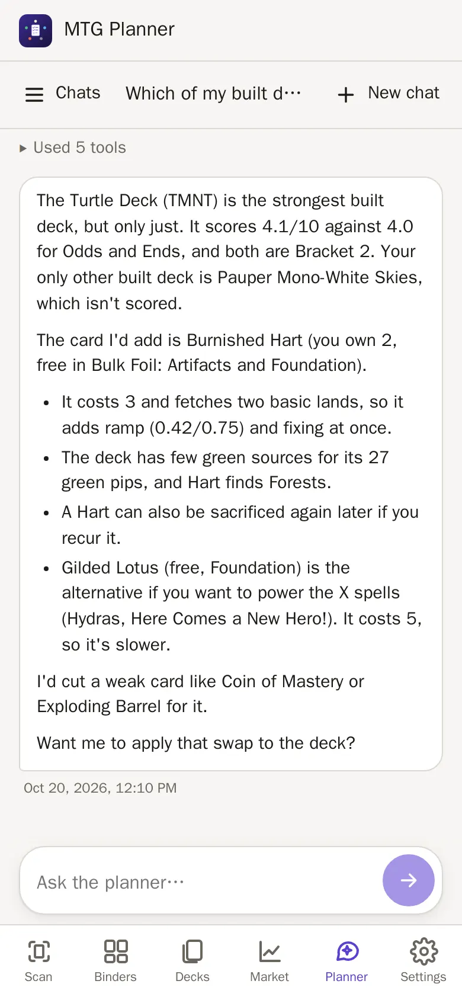

# Claude planner

How the chat works, how to connect your Claude subscription, and what Claude
can and cannot do with your data.

- [What the planner does](#what-the-planner-does)
- [Getting the token](#getting-claude_code_oauth_token)
- [Claude Code CLI (installed at runtime)](#claude-code-cli-installed-at-runtime)

## What the planner does



The **Planner** tab is a chat that runs the
[Claude Code CLI](https://claude.com/claude-code) headless
with exactly two MCP servers:

- **collection**, this repo's own MCP server: it reads your collection and
  decks, saves decks (`save_deck`), writes a deck's notes (`update_deck_notes`,
  Markdown, only the notes; the old text stays in the deck's History) and can correct owned copies
  (`edit_copies`: language, printing, finish or condition, after stating the
  exact change). It cannot delete anything; every edit is logged and can be
  undone in the app. It has no access to backups. `get_deck` and
  `list_decks` show each Commander deck's bracket and 1-10 score;
  `evaluate_deck` checks a draft list (stats, bracket, score, combos) without
  saving it, and `save_deck`/`evaluate_deck` take a `target_bracket` and answer
  OK, OVER (with the cards that push it up) or UNDER. See
  [decks.md](decks.md#bracket-and-power-score). `list_wishlist` shows the
  wishlist and `add_to_wishlist` adds a card when you ask; removing items is
  only possible in the app ([finance.md](finance.md#wishlist)).
  `get_deck_history` reads a deck's [history](decks.md#deck-history) (read-only).
- **[bmurdock/scryfall-mcp](https://github.com/bmurdock/scryfall-mcp)** gives
  access to every card ever printed, prices, the comprehensive rules, staple
  and synergy searches, and deck and mana-base analysis.

Ask things like *"Build me a budget Atraxa superfriends deck using mostly
cards I own, max €40 to buy"*. Claude checks what you own first and saves the
deck so it appears in the Decks tab as an *idea*. Ask it to build *"only from
free cards"* and it leaves the copies your built decks use alone. Answers are
kept short for a phone screen: the answer first, a few bullets, and a deck
summary instead of the full list (ask for details when you want them).
Conversations keep going across restarts (`--resume`).

Each deck has **its own chat**: ✨ on a deck page opens it (made on first use,
titled *Deck: name*) with everything said before, and sends nothing by itself.
When that chat starts a new Claude session, the first message carries the
deck's current list, notes and prices (what `get_deck` shows). Deleting the deck
keeps the chat as a normal one.

**Deck guides** (Decks → a deck → **Guide**) use Claude too, but not the chat:
one request without any tools gets the deck's facts and list and answers with
the strategy parts as JSON (`CLAUDE_GUIDE_MODEL`, default `sonnet`; budget
`CLAUDE_GUIDE_MAX_BUDGET_USD`, default 0.50; timeout `CLAUDE_GUIDE_TIMEOUT_MS`,
default 180000). It shares the limit of parallel Claude runs with the chat and
the scanner. `get_deck` tells Claude whether a deck has a guide (and whether the deck
changed since), so it can point you to it. See [decks.md](decks.md#deck-guide).

Claude's `search_collection` tool uses the same
[search syntax](collection.md#search-syntax) as the collection browser.
Binder names, each row's source (ManaBox, scan or app) and owned vs. free
copies are visible to Claude.

## Getting `CLAUDE_CODE_OAUTH_TOKEN`

On any machine where Claude Code is installed and logged in to your Claude
subscription (Pro or Max), run:

```bash
claude setup-token
```

and paste the printed token into `.env`. The planner then **uses your Claude
subscription's usage**, not API credits. Each chat turn starts one
`claude -p` process.

The planner has **no built-in Claude Code tools**: no shell, no file access
and no web. It is started with `--tools ""` and `--strict-mcp-config`, so it can
only use the two MCP servers listed above.

The same token is used by the scanner's optional Claude fallback (see
[scanner.md](scanner.md#how-a-card-is-identified)).

## Claude Code CLI (installed at runtime)

The Claude Code CLI is proprietary software of Anthropic and is **not part of
this repository or the published image**. The image's entrypoint
(`scripts/entrypoint.sh`) installs the pinned version on start:

```
npm install -g --prefix /claude/cli @anthropic-ai/claude-code@$CLAUDE_CODE_VERSION
```

It runs only when `/claude/cli` is missing or holds a different version, so it
downloads once per volume and version; later starts skip it. The install goes
into a temporary directory first, so a failed upgrade keeps the working
version. If the install fails (for example without network access), the app
still starts: the chat and the scanner's Claude fallback report that the CLI
is not installed, and `/healthz` shows
`claude_cli: {status: "missing", ...}` (`"installed"` with the version once it
works). Restart the container to retry. You use the CLI under
[Anthropic's terms](https://www.anthropic.com/legal/consumer-terms) with your
own subscription.

Related settings (`CLAUDE_CODE_VERSION`, `CLAUDE_CLI_INSTALL`, `CLAUDE_MODEL`,
`CLAUDE_MAX_CONCURRENT`, `CLAUDE_TIMEOUT_MS`) are listed in
[setup.md](setup.md#configuration).
