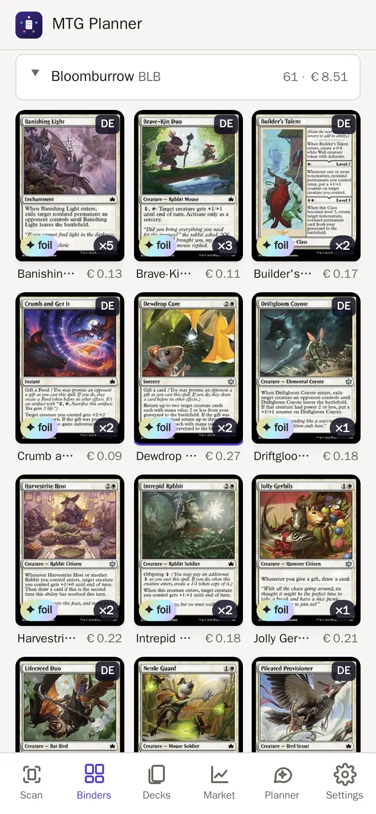
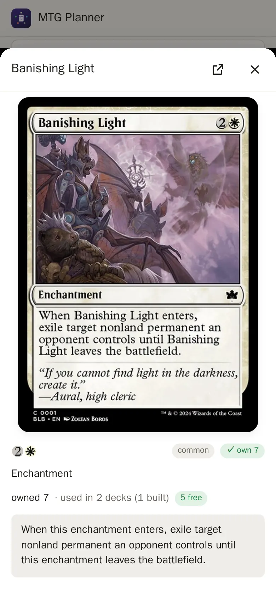
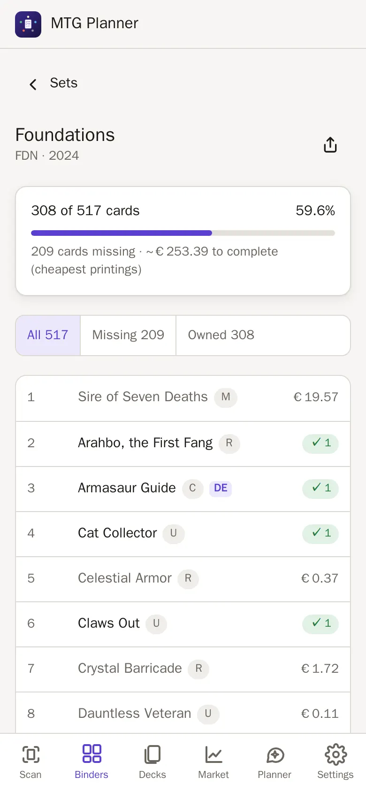

# Collection, binders and imports

How your collection gets into the app, how binders work, who is the "master"
of your collection, how to edit copies, and the search syntax.

- [Importing from ManaBox](#importing-from-manabox)
- [Adding a card list](#adding-a-card-list)
- [Browsing and searching](#browsing-and-searching)
- [Binders](#binders)
- [The collection master](#the-collection-master)
- [Editing owned copies](#editing-owned-copies)
- [Sets](#sets)
- [Exporting](#exporting)
- [Search syntax](#search-syntax)
- [API](#api)

## Importing from ManaBox

You keep your collection in the [ManaBox](https://manabox.app/) app and upload
its CSV export from your phone's browser.

1. In ManaBox, open **Collection** and tap the **⋯** menu, then **Export**,
   then **CSV**. You can also export a single binder.
2. Save or share the file to your phone.
3. In mtg-planner, open **Settings** (gear icon), pick the file and choose a
   mode. The default follows the [collection master](#the-collection-master):
   *Replace (sync)* while ManaBox is the master, *Only new copies (delta)* once
   mtg-planner is. *Add everything* adds every copy in the file again.

The three modes:

- **Replace** does a full sync: ManaBox is the source of truth. It replaces
  only rows that came from ManaBox. A *replace* upload in which nothing can be
  resolved is refused, so the collection is never wiped by accident.
- **Delta** (only new copies) adds only the copies that are new since the last
  ManaBox export. Fewer copies are reported but never deleted, and the same
  file imported twice changes nothing.
- **Add** adds every copy in the file again (the app warns about duplicates).

The app remembers the last ManaBox export (every import rewrites that
snapshot). A *delta* import compares the file with it per printing, finish,
language, condition and binder: increases are added into their ManaBox binder,
decreases are listed as "ManaBox has fewer copies of X (−n)" and nothing is
deleted.

**Put the cards into** (optional, chosen per import): *Binders as in ManaBox*
(default), *Unsorted*, one of your binders, or a *new binder*. Every card of
the file then goes into that binder; deck binders still become decks. The
snapshot uses that binder too, so importing the same file into another binder
adds its cards there.

Every printing is resolved against Scryfall, which also refreshes its price.
ManaBox **deck binders** become decks automatically (a *replace* import also
removes decks whose binder is gone), and **list binders** (wish lists) are
skipped.

The import needs the `Name` column plus either `Scryfall ID` or `Set code`.
It also understands `Collector number`, `Foil`, `Quantity`, `Condition`,
`Language`, `Purchase price`, `Purchase price currency`, `Binder Name` and
`Binder Type`. Comma and semicolon delimiters both work, and a UTF-8 BOM is
fine.

## Adding a card list

Bought a preconstructed deck or a few singles? Add them as a text list, no
scanning needed.

- **A deck you bought:** **Decks → Import decklist**, paste the list, tick
  **I own these cards**. The app saves the deck as *built* and puts the cards
  into its deck box (default `Deck box: <deck name>`, you can change it).
- **Just cards:** **Settings → Import → Card list**. Paste the list and pick
  a binder (empty = Unsorted).
- Pick the **language** and **condition** of the copies once for the whole list.
- The format is the usual decklist: `1 Sol Ring`, `1 Sol Ring (C21) 263` for an
  exact printing, `*F*` for foil, `*E*` for etched. A name without a set takes
  Scryfall's current printing. The **maybeboard** is not added (you don't own it).
- Lines the app doesn't understand or can't find are listed, the rest is added.
- The whole list is **one entry in Recent changes** (Settings → Collection), so
  **Undo** takes all copies away again. The deck stays; delete it by hand.
- The new copies belong to the app (source `app`): ManaBox imports leave them alone.

## Browsing and searching

The **Binders** tab opens on an overview of your binders (see
[Binders](#binders)). **All cards** at the top shows the whole collection;
tapping a binder opens just that binder. Both use Scryfall-style search syntax (`t:creature c<=bg
cmc<=3 eur>2 -is:foil`, see [Search syntax](#search-syntax)). You can group by
card or by printing and sort by name, mana value, price, quantity, set or
rarity. Card details show every printing you own and every deck that uses
the card.

Prices are in EUR. A foreign printing without its own EUR price uses its
English printing's EUR price, so values never fall back to USD.

## Binders

A binder is a named group of owned copies; copies without one are *Unsorted*.

**Overview.** The **Binders** tab starts with one entry per binder: a cover
card, the number of copies and the value in EUR. On a phone this is a compact
list, on a wide screen a grid of tiles. Binders are grouped by **type**:

| Type | Set |
| --- | --- |
| *Deck box* | automatically for names like `Deck box: …` or `Commander Deck: …`, and for binders a deck is boxed in or synced from |
| *Binder* | automatically for everything else |
| *Bulk*, *Trade*, *Other* | by you |

**Find binders.** The search box above the binders finds the binders that hold
matching cards (same [search syntax](#search-syntax) as everywhere). Only those
binders stay on the page, each with how many cards match. Tap one: it opens
with the search already filled in, so you see the matching cards right away.

- The colour buttons add `c:w`, `c:u`, … to the search (colourless = `c:c`).
- **★ Favourites** shows only your favourite binders. Mark one with the **☆**
  in the binder's header (Unsorted can't be a favourite).
- **Clear filters** resets the search and the favourites filter.

**Locked binders** (🔒). A locked binder keeps its cards for its own deck:
other decks, the build list and the planner don't count them as free
("🔒 in … · locked"). A locked binder without a deck is kept from every deck.

- Tap the **lock** next to the share button on a binder's page to lock or
  unlock it. The **⋯** menu shows it too, with **Back to automatic**.
- Automatic: *Deck boxes* are locked, every other binder is unlocked.
- The overview shows a small 🔒 on locked binders. *Unsorted* can't be locked.
- Link a binder to its deck in the **⋯** menu (**Belongs to deck**); a box
  whose name looks like a deck asks once "Looks like the box of …?".

Details: [decks.md](decks.md#locked-binders).

A binder with more than 1,000 copies asks once: "Looks like bulk?" Answer
**Yes** or **No** and it never asks again. The cover is the binder's most
valuable card unless you pick one. *Unsorted* shows up when it holds copies.

**A binder's page.** Tap a binder to open it. The browser's back button
returns to the overview, and a reload keeps you where you were. The page has:

- the binder name as a switcher: tap it to jump to another binder;
- its own search (the full [search syntax](#search-syntax), only inside this
  binder), sort and grid/list view;
- **sections** by set, colour, rarity or type. Big binders (more than 300
  copies) start in sections by set. A section loads its cards only when you
  open it, so a binder with thousands of copies stays fast;
- the **⋯** menu: type, lock, the deck a deck box belongs to, cover card, rename (renaming onto an existing name
  merges the two) and delete. Deleting asks what happens to the cards: move
  them to *Unsorted* (default) or delete them too (logged and undoable, see
  [Editing owned copies](#editing-owned-copies)).

**Share** (the arrow next to the binder name, also on *All cards*) sends a
link to the page (`#collection/binder/<name>`, `#collection/all`): the phone's
share menu, else the link is copied. Anyone on your home network opens it
straight in the app.

**New binder** and **Manage** (rename, type and delete for every binder) sit
at the top of the overview. Tapping the Binders tab again returns there.
- a card's details list every owned copy with a **Move…** action: pick how
  many copies and the target binder (or a new one).
- **Select** turns the grid or list into a selection; **Move to…** moves every
  copy of the selected cards, or, on a binder's page, only the copies in that
  binder. **All** selects every card of the current view (search + binder, all
  pages and sections), at most 1000 at once.

## The collection master

**Who is the master of the collection?** By default ManaBox is: a *replace*
import rebuilds every row that came from ManaBox. The first time you move,
rename or unsort ManaBox cards in the app, mtg-planner asks once and then
becomes the master:

- the moved copies turn into app-owned rows (source `app`) that no import
  touches, so your binder assignments win;
- ManaBox imports default to **Only new copies (delta)**; *Replace* stays
  available behind an explicit warning (it still deletes only rows that came
  from ManaBox, and copies you already moved in the app are counted against
  the file instead of being loaded a second time, also after switching the
  master back to ManaBox);
- deleting a binder may delete its ManaBox cards too (while ManaBox is the
  master this is refused, so ManaBox data is never deleted silently).

The **Settings** tab (Collection) shows the current master and can switch it
back.

## Editing owned copies

A card's details list every owned copy with **Move… / Edit… / Delete…**:

- **Edit…** changes the language (to the same set and number in that
  language, or just the language tag), the printing (same card), the finish
  (one the printing exists in) or the condition, for some or all copies of
  that row.
- **Delete…** removes copies after a second confirmation. **Select** in the
  Binders tab can delete many cards at once (you type the number of copies
  to confirm).
- Every edit and delete shows a toast with **Undo**, and is listed under
  **Settings → Collection → Recent changes**, where it can be undone later
  (newest first, as long as the copies weren't changed again since). Undo
  restores the rows exactly.
- Editing or deleting ManaBox copies makes mtg-planner the
  [collection master](#the-collection-master), after asking once.
  Later ManaBox imports respect these changes: an edited or deleted copy is
  not loaded again while the export still lists it, and once ManaBox shows the
  same change the edit simply counts as done.
- Claude's `edit_copies` tool uses the same edits (logged with Claude as the
  author, undoable the same way); it cannot delete.

## Sets

**Binders → Sets** shows every set you own cards of and how complete it is.

- A set counts **different cards**: any printing or language of a card from
  that set counts once. A borderless or showcase version of a card you own is
  not "missing". Tokens and art cards don't count.
- Each set shows *owned / all cards*, a bar, and roughly what the missing cards
  would cost (the cheapest € printing of each in that set).
- Sort by newest, most complete, name or cheapest to finish; the search box
  finds a set by name or code.
- Tap a set for its checklist: **All**, **Missing**, **Owned**. An owned card
  opens its details. A missing card shows its picture, price and copies you own
  from *other* sets, with **Wishlist** and **Add to deck**.
- Special sets (memorabilia, mini games) are hidden; **Show … too** lists them.

The card lists come from the card index (Settings → Scanner & data): sets
released after its last refresh appear after the next nightly update.

## Exporting

**Settings → Collection → Export collection** downloads every copy you own as
a CSV file. One binder only: open it, tap **⋯**, then **Export**.

- **ManaBox CSV** uses ManaBox's own export layout: binder, set, number,
  finish, condition, language, quantity, purchase price. Import it in ManaBox
  as a CSV, or into another mtg-planner (Settings → Import). Copies from the
  scanner and copies changed in the app are included.
- **Spreadsheet CSV** has simpler columns plus the € price per copy and per
  line, and where each copy came from (ManaBox, scanner, app).

What ManaBox keeps from the file (binders, for example) is up to ManaBox.

## Search syntax

The collection browser and Claude's `search_collection` tool use the same
query language. Terms are combined with AND, a leading `-` negates a term, and
values with spaces go in quotes.

| Query | Meaning |
| --- | --- |
| `bolt`, `n:"sol ring"` | name contains |
| `t:creature`, `t:legendary` | type line contains |
| `o:"draw a card"` | oracle text contains (exact wording) |
| `ft:"creature dies"` | full-text: all words, any order and word form ("dies", "died") |
| `role:ramp`, `role:draw`, `role:interaction` | the app's own card roles (ramp incl. fast mana, draw, removal, counter, wipe, tutor, protection, recursion, …; `interaction` = removal, counters and wipes) |
| `otag:sacrifice-outlet` | [Scryfall Tagger](https://tagger.scryfall.com/) tag (community data, fetched from Scryfall on first use and kept 30 days; not every card is tagged) |
| `k:flying` | has keyword |
| `c:wu` | colors include white **and** blue |
| `c=wu`, `c!=wu` | exactly / not exactly white-blue |
| `c<=wu` | only white and/or blue (or colorless) |
| `c<wu`, `c>u` | strict subset / superset |
| `c:m`, `c:c` | multicolor / colorless; `c:red`, guild and shard names (`c:azorius`, `id:esper`) also work |
| `id:bg` | color identity within black-green (commander deck building) |
| `cmc<=3`, `mv=2` | mana value (`= < > <= >= !=`) |
| `r:mythic`, `r:u` | rarity (`common`, `uncommon`, `rare`, `mythic`, `special`, `bonus`) |
| `s:mh3` | set code |
| `f:commander` | legal (or restricted) in format |
| `is:foil`, `is:nonfoil`, `is:etched` | owned finish |
| `is:commander` | legendary creature or "can be your commander" |
| `eur>5`, `usd<1` | price of the owned finish (foil/etched prices for foil/etched copies) |
| `qty>=4` | total owned copies (summed over the grouped rows) |
| `avail>=1` (`free`, `available`) | copies not claimed by built decks and not in a locked binder (all printings; `avail<0` = short) |
| `used>=1`, `is:used`, `used:no` | copies claimed by built decks or lying in locked binders |
| `b:"trade binder"` | binder name contains (any binder) |
| `lang:de` | card language |
| `src:manabox`, `src:scan`, `src:app` | where the copy came from (ManaBox import, scanner, organised in the app) |
| `-t:land` | negation of any term |

Terms are ANDed. Use `or` for alternatives and parentheses to group them; `-`
also negates a group. `or` binds weaker than the spaces, so
`t:creature c:u or bolt` means (blue creatures) or bolt.

| Type this | Finds |
| --- | --- |
| `t:goblin or t:elf` | goblins and elves |
| `c:r (t:instant or t:sorcery)` | red instants and sorceries |
| `-(s:lea or s:leb)` | everything except Alpha and Beta |

Quote a value that contains parentheses or the word or (`"or"`). `qty` can't
be combined with other terms by `or` (search it separately).

Unknown keys return an error that lists the supported syntax.

## API

JSON; state-changing calls need `Content-Type: application/json` and a
same-origin request.

| Route | |
| --- | --- |
| `GET /api/binders` | `{binders: [{name, cards, unique_cards, copies, sources, by_source, created_at, empty, type, type_auto, type_set, type_suggest, value_eur, top, cover, decks, locked, locked_set, locked_auto, box_deck, deck_suggest, favorite}], unsorted, collection_master}`; `type` is `binder`, `deck_box`, `bulk`, `trade` or `other` (`type_set` = picked by the user, else `type_auto`); `type_suggest: "bulk"` for a big untyped binder; `cover {scryfall_id, name, image, image_small, chosen}`; `top` = the most valuable card; `decks` = decks boxed in or synced from it; `locked` = effective lock (`locked_set` = set by the user, else `locked_auto` = it is a deck box); `box_deck {id, name, status, via link\|manabox\|name}` = the deck that owns a locked binder or deck box (null = nobody); `deck_suggest {id, name, status, similarity}` = a deck whose name closely matches an unowned box |
| `POST /api/binders {name}` | create an empty binder: 201, 409 if it exists, 400 if empty or longer than 100 |
| `GET /api/binders/search?q=` | binders holding cards that match `q` (search syntax): `{q, cards, binders: [{name, cards, copies}]}` (`''` = Unsorted; `cards` = matching cards in the whole collection); 400 for a bad query |
| `PATCH /api/binders/:name {name?, type?, cover_scryfall_id?, deck_id?, locked?, favorite?, confirm_master?}` | rename (merging into an existing binder; type, cover, lock and favourite come along); `favorite` true / false (400 for Unsorted); `locked` true / false, null = automatic (400 otherwise, also for Unsorted); `type` null = automatic; `cover_scryfall_id` must be a printing in the binder, null = most valuable card; `deck_id` links the deck that owns this box (sets that deck's `box_binder`, clears any other deck's link to this binder and the deck's previous box; null unlinks; 400 not an id, 404 no such deck) |
| `DELETE /api/binders/:name?cards=unsort\|delete&confirm_master=1` | delete; `unsort` (default) moves the cards to Unsorted, `delete` deletes them (logged in the edit log, undoable) |
| `POST /api/collection/move` | `{items, to_binder, create?, confirm_master?}`; an item is `{scryfall_id, finish, language, condition, binder, source?, quantity}` (copies of one row key), `{oracle_id, from_binder?}` (every copy of a card) or `{printing_id, from_binder?}` (every copy of a printing); `to_binder: ""` is Unsorted |
| `GET /api/sets?all=1` | `{sets: [{code, name, set_type, parent_set_code, released_at, cards, owned, missing, pct, missing_eur, unpriced, copies}], hidden}`: sets with at least one owned card, newest first; `cards` = distinct cards (oracle ids) of the set without tokens/art cards; `owned` = of those you own in any printing/language of the set; `missing_eur` = cheapest English EUR printing per missing card (`unpriced` without one); memorabilia/minigame/vanguard/token sets only with `all=1` (`hidden` = how many were left out); 503 without a card index |
| `GET /api/sets/:code` | `{set, cards: [{oracle_id, name, rarity, eur, id, image_small, collector_number, printings, owned, langs, finishes, owned_id, elsewhere}], totals: {cards, owned, missing, missing_eur, unpriced, pct}}` sorted by number; `id` = the cheapest English printing, `owned_id` = an owned printing (card sheet), `elsewhere` = copies owned from other sets; 404 unknown set |
| `GET /api/collection/export?format=manabox\|csv&binder=` | CSV download of the owned copies (all sources; `binder` as below, omitted = all); `manabox` (default) = ManaBox's export columns, read back by the importer; `csv` = name, set, set_name, collector_number, finish, language, condition, binder, quantity, price_eur, value_eur, source, scryfall_id; 400 for another format |
| `GET /api/collection?binder=` | the collection list filtered by exact binder (`binder=` = Unsorted); `section_by=set\|color\|rarity\|type&section=<key>` = one section |
| `GET /api/collection/sections?by=set\|color\|rarity\|type&q&group&binder` | `{by, sections: [{key, label, cards, copies, value_eur}]}` for the same view as `/api/collection` |
| `GET\|PATCH /api/settings` | `{collection_master: "manabox" \| "app"}` (also in `GET /api/stats`) |
| `POST /api/import/manabox?mode=replace\|delta\|add&binder=&create_binder=1` | raw CSV body; `binder` puts every card into that binder (empty = Unsorted, a new name needs `create_binder=1`, else 404); the summary lists `added` and `decreased` rows in delta mode |
| `POST /api/collection/import-list {text, binder?, create?, language?, condition?, deck?: {name, format?}}` | add a decklist-format card list (≤1000 lines) as new `app` copies of one binder (`""` = Unsorted, a new name needs `create` (default true), else 404), language `en` and condition `near_mint` by default; commander/main/side lines only; with `deck` also a built deck (every board) whose deck box is that binder; 201 `{binder, created, added_copies, cards, unresolved, parse_errors, edit_id, deck_id}`; one undoable `add` entry in `/api/collection/edits`; 400 when nothing was found |
| `POST /api/refresh-prices` | re-fetch card data and prices of everything you own or use in a deck |
| `PATCH /api/decks/:id {status}` | `idea` or `built` |
| `GET /api/shopping-list` | `{built: {items, total_eur}, per_deck: [{id, name, status, to_buy_count, to_buy_eur, in_use_count, in_use_eur}]}` |
| `POST /api/decks/:id/to-binder {binder?, confirm_master?}` | move the deck's owned copies into `Deck box: <name>` (or `binder`); returns `moved` and `missing` |

A move, rename or unsort that touches ManaBox rows while ManaBox is the master
answers `409 {code: "confirm_master", manabox_copies}`; repeat it with
`confirm_master` to proceed. A *replace* import while mtg-planner is the master
answers `409 {code: "confirm_replace"}` unless `confirm_replace=1` is set.

Editing copies: `POST /api/collection/edit {items, set: {language?,
printing_id?, finish?, condition?}, confirm_master?}`,
`POST /api/collection/delete {items, confirm: true, expected_copies?,
confirm_master?}` (items as for `/api/collection/move`; `expected_copies` = the
number of copies the user confirmed: when the items now select another number,
nothing is deleted and the answer is `409 {code: "changed", copies}`),
`GET /api/collection/edits` and `POST /api/collection/edits/:id/undo`.
