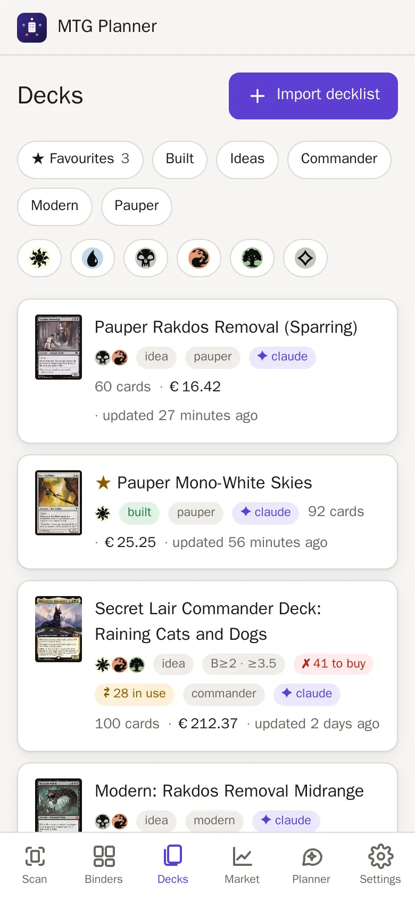
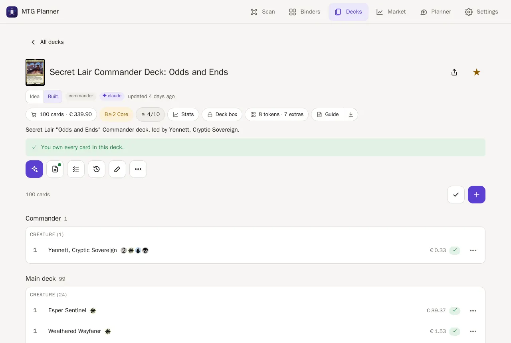
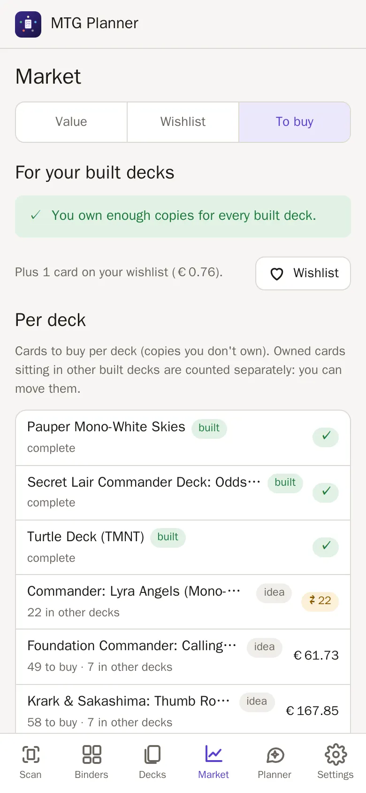

# Decks

How decks, idea vs. built decks, conflicts, to-buy lists, locked binders,
the build list, the deck history, deck stats and the power level (bracket and
score) work.

- [Adding decks](#adding-decks)
- [Favourites and filters](#favourites-and-filters)
- [What a deck shows](#what-a-deck-shows)
- [Deck stats](#deck-stats)
- [Bracket and power score](#bracket-and-power-score)
- [Combo check (Commander Spellbook)](#combo-check-commander-spellbook)
- [Idea vs. built decks](#idea-vs-built-decks)
- [Locked binders](#locked-binders)
- [To buy](#to-buy)
- [Put into deck box](#put-into-deck-box)
- [Build list](#build-list)
- [Deck history](#deck-history)
- [Deck guide](#deck-guide)
- [API](#api)

## Adding decks

- Paste a list in MTGA, Moxfield or ManaBox format. A deck you **bought**
  (a precon): tick **I own these cards**, and the cards go into your
  collection too, in the deck's box (see
  [collection.md](collection.md#adding-a-card-list)).
- Let Claude build one in the [planner](claude.md); it is saved as an *idea*.
- ManaBox **deck binders** become decks automatically on import (see
  [collection.md](collection.md#importing-from-manabox)).
- Add scanned cards straight to a deck (see
  [scanner.md](scanner.md#scan-list--binder-or-deck)).
- **＋ (Add card)**, right above the card list: search a card, pick the printing, choose the board
  (main, side, maybe, commander) and the copies. From any card's details,
  **Add to deck** does the same for a deck you pick.
- **Select** on a deck: tick cards (or **All**), then **Remove** them or
  **Move…** them to another board. One step = one version in **History**, so
  you can go back.
- One card at a time: the **⋯** next to a card opens a small menu: card details,
  set as commander, move to another board, copies − / +, remove.

Decks can be exported as a text list you can import elsewhere.

## Favourites and filters

- Tap **☆** next to a deck's name to make it a favourite (★). It is not a deck
  change: no new version in the history.
- Above the deck list: **★ Favourites**, **Built**, **Ideas**, one button per
  format your decks use, and the colours. Filters combine.
- A colour shows decks whose colour identity includes it (two colours = both).
  Colourless shows only colourless decks.
- Each deck row shows its colour identity as mana symbols.
- The filters are remembered on the device. **Clear filters** resets them.

## What a deck shows

The deck page is compact. **Chips** under the name open pop-ups: cards and value,
bracket, power score, **Stats**, the deck box, **Tokens & extras** and the **Guide**
(with a PDF download next to it). **Icon buttons** below: ✨ the deck's planner chat, 📄 guide
(a dot when one exists), ☑ build list, 🕘 history, ✏ edit, and **⋯** for put into deck
box, export and delete. Above the cards: filter (only cards to buy), select and ＋ add.
Hold the pointer on an icon (or long-press) to see its name.

- Each card shows how many copies you own (counted across all printings) and
  how many are **missing**.
- The deck shows its **value in EUR** (owned, to buy, maybeboard) and the
  **cost of the missing cards**. Copies are shared between main, side and
  maybe boards. Basic lands are never missing.
- You can set the **commander** (up to two for partner/background pairs;
  legendary creatures in the deck are suggested) and move cards between
  boards.
- **Notes**: tap **✏ (Edit)** on a deck to write notes in Markdown (`## headings`,
  `- lists`, `**bold**`, `{G}` for mana symbols, up to 5,000 characters). Long
  notes fold up with **Show more**. Claude can write them too when you ask
  ("write a game plan into the notes"). Every change is a version in **History**.
- A **cover picture**: the commander, else the most expensive card (EUR,
  basic lands never). The deck list shows it as a thumbnail on phones and as
  the card art on wider screens.
- **Share** (the arrow next to the deck name) sends a link to the deck
  (`#decks/<id>`): the phone's share menu, else the link is copied. Anyone on
  your home network opens it straight in the app.

## Deck stats

Tap the **Stats** chip on any deck (every format); it opens as a pop-up:

- **Mana curve:** how many cards cost 0, 1, 2 … 7+, split into creatures and
  other spells. X spells get an "X" mark.
- **Colours:** for each colour, how much the spells ask for (mana symbols)
  and how many lands make it. A warning shows when the lands fall behind.
- **Facts:** lands (double-faced cards with a land back count extra), average
  mana value, creatures, instants and sorceries.
- The commander and a companion are shown as chips. Side and maybe boards are
  not counted.
- Cards without card data yet are listed as **unknown**, never as free.

## Tokens & extras

Open **Tokens & extras** on any deck (also while you only plan it) to see what
you need on the table besides the cards:

- **Tokens**: picture, name, power/toughness, which cards make them
  (*from Battle Screech ×4*), roughly how many to have ready (*have ~16*) and
  how many token cards you own, with their binder (*you own 3 (Tokens)*).
- **Counters and markers**: +1/+1 and −1/−1 counters, loyalty, poison,
  energy, lore, time, shield, oil and other named counters, dice (with their
  size), coins, the Monarch, the Initiative, Day/Night, City's Blessing,
  dungeons, The Ring, emblems, face-down cards and token copies. Each names the
  cards that need it.
- The estimate is a rough guide: copies × tokens per card, twice for
  flashback and for triggered or activated abilities, *X* effects count 2,
  capped at 20.
- Sideboard cards count and are marked *side*; the maybeboard is left out.
- Where the data comes from: Scryfall's list of the tokens a card makes and
  the token cards themselves (fetched once in the background and cached),
  else the card text. Without a connection the names and counts still come
  from the card text.
- The **Build list** ends with a *Tokens & extras* group: token cards you own
  per binder, the rest as *need*, then the counters and markers. They can be
  ticked but don't count towards *picked*.
- The planner sees a short *Tokens & extras* line for saved decks and drafts.

## Bracket and power score

Commander decks get two badges at the top, for example **B3 Upgraded** and
**6.5/10**. Tap one for the details. Other formats only get the stats.

A deck counts as a Commander deck when its format is Commander/EDH/cEDH, or
when it has no format (ManaBox decks) but has a commander or about 100 cards.

### The bracket (1-5)

The bracket follows WotC's official
[Commander Brackets](https://magic.wizards.com/en/formats/commander) (rules as
of 9 Feb 2026). The app only uses rules it can show you, and it names the
cards behind each one:

| What the deck has | Bracket at least |
| --- | --- |
| Nothing below | 2 |
| 1-3 **Game Changers** (WotC's list, 53 cards) | 3 |
| 4 or more Game Changers | 4 |
| **Mass land denial** (Armageddon, Blood Moon, …) | 4 |
| 3 or more **extra-turn** cards (1-2 are fine) | 3 |
| A **2-card combo** that wins or goes infinite and costs 4 mana or less to assemble | 4 |
| A slower 2-card combo, or one that only "arguably" needs 2 cards | 3 |

"Costs to assemble" = the mana the combo needs (Commander Spellbook) plus
the mana value of every piece that must already be on the battlefield. So
Thassa's Oracle + Demonic Consultation (3) counts as fast, Vito + Exquisite
Blood (3 + 5 = 8) as a slower combo.

- **Brackets 1 and 5 are your call.** They are about intent, so the app
  never sets them. Pick one in the details ("Auto" or 1-5); a ✎ shows it.
  If you pick a lower one than the rules give, the app tells you why.
- Very fast decks get a hint: **"Looks cEDH-like"**. Set 5 yourself if you
  agree.
- **Tutors don't change the bracket** (WotC dropped that rule on
  21 Oct 2025). They only count toward the score.
- **"≥3"** means "at least 3": the combo check hasn't run yet (offline, off
  or still loading) or some cards aren't identified. It can only go up.
- The 2-card combo and extra-turn rules are the app's reading of WotC's
  "no two-card combos before turn 6" and "no chaining extra turns". They are
  marked as heuristics.
- **Not legal** (red badge): banned cards, cards outside the commander's
  colours, duplicates, not 100 cards, or commanders that can't pair. It never
  changes the bracket number.
- Commander Spellbook's own estimate is shown as a second opinion only. It
  never raises the app's bracket.

### The power score (1-10)

The score says how strong the deck is *inside* its bracket. It is
1 + points from eight parts, each with a maximum:

| Part | Max | What gives points |
| --- | --- | --- |
| Speed | 1 | A low average mana value |
| Fast mana | 1.75 | Mana Vault, Chrome Mox, rituals … (Sol Ring counts less: every precon has it) |
| Tutors | 1 | Cards that search your library; cheap ones count more |
| Combos | 2 | Combos found by the combo check; fast 2-card combos count most |
| Interaction | 1 | Removal, counterspells, board wipes, free spells, protection |
| Card draw | 1 | Draw engines most, then "draw three" and cantrips |
| Ramp | 0.75 | Mana rocks, mana creatures, land search |
| Mana base | 0.5 | Lands that make 2+ of your colours, enough sources per colour |

- Each part shows as a bar with plain words and its top cards.
- The score is not tied to the bracket. When it is unusual for the bracket, a
  note says why, e.g. "Score is high for Bracket 2 because of fast mana".
  The usual ranges follow the
  [playgroup.gg bracket calculator](https://playgroup.gg/commander/bracket-calculator):
  Brackets 1-2 about 1-4.5, Bracket 3 about 4.5-7.5, Bracket 4 about 7-9.5.
- Unknown cards add nothing and are listed. Without the combo check the
  combos part is 0 and the score shows **"≥"**.
- The weights were tuned on 14 public decklists (WotC precons, upgraded
  precons, optimized decks, cEDH lists). Precons land around 3.5-4.5,
  cEDH lists around 9-9.5.

### In the planner

Claude sees the bracket and the score of every deck. Ask for a target
("build a bracket 3 deck"): Claude checks the draft with `evaluate_deck`
before saving it and swaps the cards that push it too high.

## Pauper and other 60-card formats

Decks with the format pauper, standard, pioneer, modern, legacy, vintage or
premodern are checked against their rules: at least 60 main deck cards, at most
15 in the sideboard, at most 4 copies (basics and "any number" cards excepted,
restricted cards once) and every card legal in the format. A deck that breaks
them shows **✗ Not legal** on its page (tap it for the reasons). They get no
bracket or score; the planner compares Pauper decks with the current MTGO
tournament lists instead (`compare_to_meta`).

## Gaps and goldfish

The planner can measure a deck in two ways (also part of `evaluate_deck`):

- **Gaps** (`deck_gaps`): lands, ramp, card draw, removal, board wipes,
  protection and recursion (from bracket 3), cheap plays, average mana value
  and colour-fixing lands, compared with the middle half of tuned public decks
  of the same format and bracket. The numbers come from about 440 decklists
  (Archidekt by bracket, WotC precons, MTGO Pauper lists), counted with the
  app's own card roles, so your deck and the reference are measured the same
  way. Every LOW gap comes with your free cards that fill it.
- **Goldfish** (`simulate_deck`): 10 000 solo games with London mulligans,
  one land a turn and the deck's own mana sources. It reports keepable hands,
  land drops on turns 3 and 4, colour screw on turn 4, flood on turn 6,
  interaction by turn 3, the turn the commander comes down and, when known,
  the turn a combo is assembled. Same list, same numbers, so a change can be
  shown as before → after.

## Combo check (Commander Spellbook)

Combos come from [Commander Spellbook](https://commanderspellbook.com/)
("Combos by Commander Spellbook"). Each combo links to its page there.

**What is sent:** for Commander decks only, the **card names and
quantities** of the commander and main deck. Nothing else from your
collection, no prices, no deck names. Like any web request it also reveals
your server's public IP address.

**When:** after a Commander deck changes (also ManaBox import rebuilds and
drafts Claude checks with `evaluate_deck`), at most one call every 1.5 s.
Results are cached for 14 days; identical decks share a result.

**Turn it off:** Settings → **Online services** → **Check combos online**.
To force it off for good, set `SPELLBOOK_ENABLED=false` in `.env` (this wins
over the switch, also for the planner). When it is off or the service can't
be reached, the app still works: the bracket and score show "≥" and combos
show as not checked.

Commander Spellbook asks API users to keep to a few calls per user action and
under 80 per minute, and to name the app; the app does all three (usage notes
in the [API description](https://backend.commanderspellbook.com/schema/)).
Its backend is MIT-licensed
([source](https://github.com/SpaceCowMedia/commander-spellbook-backend)).

## Idea vs. built decks

A deck is an *idea* (a plan) or *built* (a physical deck; decks synced from
ManaBox deck binders start as built).

- Built decks **claim** their copies (commander, main and side boards; basic
  lands never count), so every deck and card shows *owned* and *free* copies.
- A card you own but that another built deck uses is shown as **in other
  decks** ("can be moved"), separate from what you still need **to buy**.
- Two built decks that need more copies than you own are flagged as a
  **conflict**.
- Copies in a **locked binder** belong to its deck: see below.

## Locked binders

A precon or a boxed deck stays whole: its cards are not used for other decks.

- Lock a binder with the 🔒 button on its page (see
  [collection.md](collection.md#binders)). *Deck boxes* are locked
  automatically, every other binder starts unlocked.
- Copies in a locked binder are **free only for the deck that owns it**.
- Every other deck shows them as **🔒 in <binder> · locked**, like copies
  another built deck has. They are never free and never "to buy". The deck
  page says how many cards are **only in locked binders**.
- A locked binder **nobody owns** (e.g. `Commander Deck: …` with no deck in
  the app, or a binder you locked yourself) is kept from every deck.
- A built deck's own box and its claim count once: the deck takes its cards
  from its own box first.
- A lock never makes a **conflict**; conflicts stay between built decks.
- Basic lands stay free, also in a locked binder.
- To use the cards freely, unlock the binder (🔒 button or **⋯ → Lock**).

**Which deck owns a box?** The deck linked to it: binder **⋯ → Belongs to
deck**, or *Put into deck box*. A ManaBox deck owns its ManaBox binder, and a
binder named like the deck (or `Deck box: <deck>`) counts too. One box per
deck, one deck per box. When a box's name looks like a deck's name
(`Secret Lair Commander: Odds and Ends` ↔ `Secret Lair Commander Deck: Odds
and Ends`), its page asks once: "Looks like the box of …? **Link** / **No**".
It never links on its own. The deck page shows its box under the value.

## To buy

Each deck shows its own **To buy** list. **Export list** below it downloads
the cards as a text file (`3 Counterspell`, one per line). **Market → To buy** shows what each
deck still needs and, across all built decks, what to buy with a € total (see
[finance.md](finance.md#to-buy)).

## Put into deck box

**Put into deck box** moves the copies a built deck needs into a
`Deck box: <name>` binder:

- Unsorted copies are taken first, then plain binders. Never copies out of
  a locked binder (any other deck's, or nobody's) or another built deck's binder.
- The box is remembered, also when the deck or the binder is renamed.
- After you change the deck, putting it into the box again also **takes out** what
  the deck no longer needs: cards that left the deck and copies beyond a lowered
  count go to **Unsorted**, and the result lists them under "Take out of the box",
  so the real box matches. This also happens when the build list puts only the
  ticked cards in.
- A ManaBox deck's own binder already counts as boxed.

## Build list

**Build list** helps you collect a deck's cards from your binders, mainly for
an idea deck you are about to build.

- Cards are grouped by the **binder** their free copies are in (Unsorted
  first). It uses the same order as *Put into deck box*. Within a group the
  cards are sorted by name, like a sorted binder.
- Every line shows the card's mana cost and its German name in brackets
  (`CARD_NAME_LANG`, see [Setup](setup.md)). Tap the small picture on the right
  to see the card; the line itself is the tick.
- **In other decks or locked binders**: you own them, but another built deck
  or a locked binder has them ("🔒 in … · locked").
- **Basic lands**: basics you don't own enough of.
- **To buy**: cards you don't own, with prices.
- **Already in …**: copies already in the deck box. They count as picked.
- Tap a card to tick it. Ticks are saved on the server, so you can switch
  devices. A bar shows *23 / 61 picked*.
- At the end: **Put picked cards into deck box** (moves only the ticked cards)
  and **Mark deck as built**.
- Ticking never moves cards. A card that leaves the deck loses its tick.

## Deck guide

**Guide** on a deck writes a short guide for learning to play it, in plain
English for beginners:

- **At a glance:** commander, colours, cards, lands, average mana value,
  bracket and power score, value.
- **How it wins**, a **turn-by-turn** plan (early, middle, late) and
  **mulligan** rules: when to keep a hand and when to shuffle it away.
- **Key cards** with pictures and why they matter.
- **Techniques this deck uses** (ramp, card draw, removal, tokens, sacrifice,
  graveyard, blink, evasion …): what each one is, how *this* deck uses it, and
  which cards do it.
- **Watch out** (common mistakes), **Learn it** (practice steps), the tokens
  you need, and **Words to know** (every keyword on the cards).

The facts, techniques and glossary are worked out by the app. The strategy
parts (how it wins, turns, mulligan, key cards, tips) are written by Claude in
one request (about half a minute, on your Claude plan; nothing else is sent
anywhere). Without Claude the guide has the facts and techniques only. The
newest five guides per deck are kept; after you change the deck, the guide
says so and **Write it again** makes a new one. Once written, the guide also
shows on the deck page itself, with **Open** and **PDF**.

Tick **Also put the TL;DR into the deck notes** before writing it and the
summary plus how the deck wins go to the top of the deck's notes. A new guide
replaces that block; your own notes below it stay, and the old text is in the
deck's History.

**Download PDF** gives the same guide as an A4 file to print or keep: the deck at
a glance with the commander's picture and a mana-curve chart, then the plan,
key cards with pictures, one box per technique and the glossary. Card pictures
come from Scryfall's image server when the PDF is made (without internet the
PDF has text only).

## Deck history

Every change to a deck is saved as a **version**: edits in the app, decks
Claude saves, ManaBox imports and scanner commits.

- **History** lists the versions: when, who (you, Claude, ManaBox import,
  scanner) and what changed (for example *+2 −1 cards*).
- Tap a version to see what was added, removed or changed per board.
- **Restore this version** puts its cards, name, format and bracket back. It is
  saved as a new version, so nothing is lost. The status (idea / built) stays.
- The newest 50 versions per deck are kept. Saving the same state twice does
  not add a version. Deleting a deck deletes its history.
- Decks that existed before the history started get one starting version.
- Claude can read a deck's history (`get_deck_history`), but can't restore it.

## API

JSON; state-changing calls need `Content-Type: application/json` and a
same-origin request.

| Route | |
| --- | --- |
| `GET /api/decks/:id` | the deck; adds `cover: {scryfall_id, name, image_small, image_normal, image_art, source}` (`source` is `commander` or `top`; null without a card image; the rows of `GET /api/decks` carry it too) and `accessories: {status, tokens: [{key, name, type_line, pt, colors, oracle_text, image_small, scryfall_ids, source, from: [{name, quantity, side?}], estimate, estimate_note, side_only?, owned: {quantity, binders: [{binder, quantity}]}}], markers: [{key, label, kind, note?, sizes?, from, side_only?}], maybe_skipped, unknown}`; `status` is `ok`, `pending` (token data is being fetched: read again after a few seconds) or `unavailable` (card text only); locked binders: `box {binder, via}` (the box this deck owns), per card `in_locked` `[{binder, deck_id, deck_name, quantity}]` (locked binders of other decks or nobody holding it) and `in_use_locked` (the part of `in_use` lying there), `in_use_locked_count` (the list rows carry it too); per card `to_buy` and `in_use`, deck `to_buy_count`, `to_buy_eur`, `in_use_count`, `in_use_eur` (list rows too), and `shopping.in_use[]` items add `boxes` and `in_box` |
| `POST /api/decks/evaluate` | also returns `accessories` for the draft |
| `GET /api/decks/:id/guide` | `{status: none\|pending\|ready, started_at, error, notes_error, claude, guide}`; `guide` = the newest `{id, created_at, kind: full\|facts, model, cost_usd, stale, guide: {deck, commander, colours, counts, curve, types, value_eur, power, techniques: [{key, name, what, tip, cards, count}], glossary, tokens, combos, key_cards: [{name, why, image}], strategy: {summary, how_it_wins, game_plan: {early, mid, late}, mulligan: {keep, ship}, pitfalls, practice} \| null}}`; `stale` = the deck has a newer history version; `error` = the last failed Claude part |
| `GET /api/decks/:id/guide.pdf` | the newest guide as an A4 PDF download (`<deck> - guide.pdf`; lib/guidepdf.js, card pictures from cards.scryfall.io, skipped offline); 404 without a guide |
| `POST /api/decks/:id/guide {facts_only?, update_notes?}` | `update_notes`: the full guide's TL;DR also goes to the top of the deck notes. Write a guide: with Claude in the background (202, poll GET; 409 while one runs, 429 Claude busy), or facts only at once (201; also without a Claude token) |
| `POST /api/decks/:id/cards {scryfall_id \| name, board?, quantity?}` | add copies of a card (board `main` by default, 1-999 copies) to a board, merged into a row of the same name; by `scryfall_id` that printing, by `name` an owned printing first, else Scryfall's; returns the deck plus `change: {name, board, scryfall_id, added}`; 404 deck or card not found, 400 bad board/quantity/id |
| `POST /api/decks/:id/cards/bulk {items: [{name, board}], action, to_board?}` | `action` `remove` or `move` (with `to_board`) for 1-500 rows in one step and one history version; returns the deck plus `change: {action, rows, copies, to_board}`; a row that isn't there → 404 and nothing changes |
| `GET /api/decks/:id/build` | the build list: `{deck_id, name, status, box_binder, total, picked, complete, movable_picked, groups: [{key, kind, title, binder?, quantity, picked, lines: [{key, source, name, local_name?, quantity, picked, oracle_id, scryfall_id, image_small, mana_cost, cmc, colors, commander, binder?, decks?, price_eur?}]}]}` (`local_name` = the printed name in `CARD_NAME_LANG` when the card index has one); `kind` is `binder`, `other`, `basics`, `buy`, `box` or `tokens` (token lines with `token`, `need`; marker lines with `marker`; not counted in `total`/`picked`) |
| `PUT /api/decks/:id/build/picks {key, source, quantity}` | tick (`quantity` = the line's copies) or untick (`0`) one line; returns the list; 404 when the line is gone |
| `DELETE /api/decks/:id/build/picks` | untick everything; returns the list |
| `POST /api/decks/:id/to-binder {binder?, confirm_master?, picked_only?}` | *Put into deck box*; `picked_only: true` moves only the cards ticked in a binder group (400 when none) |
| `GET /api/decks/:id/history` | `{deck_id, keep, versions: [{id, at, actor, summary, card_count, name, restored_from, current}]}`, newest first; `actor` is `app`, `claude`, `import`, `scan` or `system` (starting version) |
| `GET /api/decks/:id/history/:version` | `{version: {…, meta, cards}, diff, restore}`: `diff` = changes against the version before (null for the oldest), `restore` = what restoring would change |
| `POST /api/decks/:id/history/:version/restore {confirm: true}` | restore that version (400 without `confirm`); returns the deck plus `restored: {version_id, restored_from}` |

A diff is `{boards: [{board, added: [{name, quantity}], removed: [...],
changed: [{name, from, to, printing?}]}], meta: [{field, from, to}], added,
removed, moved}`.
