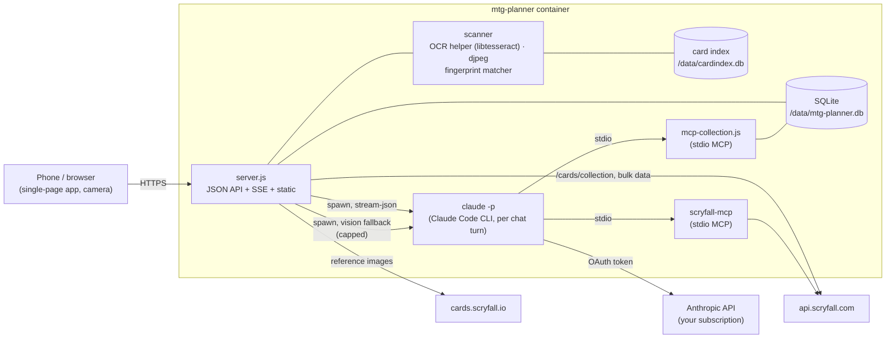

# Development

For developers: how mtg-planner is built, how to run the tests, deploy your
own build and cut a release.

- [Architecture](#architecture)
- [Code map](#code-map)
- [Building, testing and deploying](#building-testing-and-deploying)
- [Releases](#releases)
- [Third-party data and software](#third-party-data-and-software)

## Architecture

One Docker container. The web server and the collection tools are plain
Node.js with no npm dependencies, and data is stored in SQLite. The scanner
uses Tesseract OCR (through a small C helper built in the image) and `djpeg`
from Debian packages. Card data and prices come from
[Scryfall](https://scryfall.com/).



The card index is kept in a separate SQLite file, so it can be rebuilt or
deleted without touching your collection. The web server and the MCP server
open the same main database file, which runs in WAL mode with a busy timeout.

## Code map

- `server.js`: HTTP API, ManaBox import, decks, scanner, and chat over
  Server-Sent Events. It uses the Node standard library only.
- `lib/db.js`: SQLite schema (`cards`, `collection`, `binders`, `decks`,
  `deck_cards`, `imports`, `manabox_snapshot`, `collection_edits`, `chats`,
  `messages`, `scans`, `meta`) on `node:sqlite`, with versioned migrations
  (`PRAGMA user_version`), plus price helpers.
- `lib/scryfall.js`: rate-limited Scryfall client and card normalisation.
- `lib/prices.js`: copies the English printing's EUR prices to foreign
  printings that have none, so values never fall back to USD.
- `lib/query.js`: compiles the [search syntax](collection.md#search-syntax)
  to SQL.
- `lib/manabox.js`: CSV parser and ManaBox import (replace/delta/add,
  binders, deck binders), aware of edits and deletes made in the app.
- `lib/binders.js`: binders (list, create, rename/merge, delete), moving
  copies between binders, and the collection master setting.
- `lib/edits.js`, `lib/editlog.js`: editing and deleting owned copies, the
  edit log and undo.
- `lib/decks.js`: decklist parsing, name resolution (owned printings first),
  and ownership and missing-cost math.
- `lib/scheduler.js`: the nightly index and price refresh and the daily value
  snapshot.
- `lib/finance.js`: value history (`value_history`, `value_history_binders`,
  change-only `card_history`) and the Value tab views ([finance.md](finance.md)).
- `lib/wishlist.js`: the wishlist (`wishlist` table): prices, owned counts,
  the shopping-list section.
- `lib/backups.js`: manual backups (`VACUUM INTO` + gzip, manifest,
  retention) and restore (validation, safety backup, file swap with rollback).
- `lib/claude.js`: locates the runtime-installed CLI, spawns it per turn and
  turns `stream-json` into UI events. It also runs the scanner's one-shot
  vision call (no tools, no session) behind an hourly cap.
- `lib/cardindex.js`: the local Scryfall index (`/data/cardindex.db`). It
  streams the bulk import (in a worker thread, `lib/index-worker.js`) and
  handles collector-number, legacy `nnn/ttt` and fuzzy title lookups,
  printings and variants, and storage-language mapping.
- `lib/ocr.js`: OCR through the persistent helper `native/mtg-ocr.c` (a small
  C program on the libtesseract API, built in the image) or the tesseract CLI,
  collector-line parser, ★/• classifier, set-code matching, and title OCR.
- `lib/fingerprint.js`: JPEG decoding via `djpeg`, the 88-byte card hash
  (shared with the browser as `public/fphash.js`), the in-memory matcher
  (`MatcherWorker` runs it in a worker thread), and the background
  reference-hash job.
- `lib/fingerprint-worker.js`: the matcher's worker thread: loads the
  fingerprints at startup, hashes and matches scans, and serves the scanner's
  card-index lookups, so none of that blocks the HTTP server.
- `lib/scanner.js`: the identification pipeline (with the 180° retry) and the
  decision thresholds (`SCAN_THRESHOLDS`).
- `lib/scans.js`: the scan list (staging, duplicate rule, undo, +1), the
  recognition probes, commits to binders and decks, and calibration records.
- `lib/debugsessions.js`: the store for recorded scan sessions.
- `mcp-collection.js`: hand-rolled MCP stdio server (JSON-RPC 2.0) with the
  tools `collection_overview`, `search_collection`, `check_owned`, `get_card`,
  `list_decks`, `get_deck`, `shopping_list`, `list_binders`, `save_deck` and
  `edit_copies` (read-only apart from `save_deck` and `edit_copies`, no
  delete; binder names, each row's source, ManaBox, scan or app, and owned
  vs. free copies are visible to Claude).
- `public/`: the single-page web app, with no dependencies. The scanner's
  browser side: `public/det/` (card detector and tracker), `public/scanlib.js`
  (camera, cropping, glare and sharpness checks, sounds),
  `public/capture.js` (the probe loop and upload queue) and
  `public/autoask.js` (when to ask Claude about a hard card).

## Building, testing and deploying

Node.js ≥ 24 is required for the built-in `node:sqlite`. There are no
dependencies to install.

```bash
# local build instead of the GHCR image
cp docker-compose.override.yml.example docker-compose.override.yml
scripts/deploy.sh      # builds mtg-planner:<semver>-<sha>, runs the tests in it, switches, waits for healthy
# ...or build here and deploy to another Docker host over SSH (image shipped with docker save/load)
DEPLOY_HOST=user@host DEPLOY_DIR=/path/to/compose/dir scripts/deploy.sh
scripts/deploy.sh --image mtg-planner:<tag>   # switch back to an image still on the target
# defaults for DEPLOY_HOST/DEPLOY_DIR can live in scripts/deploy.local.env (gitignored);
# a dirty tree is refused unless --allow-dirty (version gets a .dirty suffix)

# tests (node:test, offline: Scryfall and the Claude CLI are stubbed; OCR and
# djpeg tests skip when tesseract/djpeg/cjpeg are not installed)
npm test
# ...or without a local Node:
docker run --rm -v "$PWD":/app -w /app node:24-slim npm test
# ...including the OCR/djpeg tests, in the built image (it has the binaries; CI does the same)
docker run --rm -v "$PWD":/app -w /app --entrypoint npm ghcr.io/klopfer-hello/mtg-planner:latest test
```

## Releases

Push a `vX.Y.Z` tag. GitHub Actions builds and pushes
`ghcr.io/klopfer-hello/mtg-planner:latest` and `:vX.Y.Z` with
`VERSION=X.Y.Z+<12-char sha>`, then creates a GitHub release whose changelog is
grouped by Conventional Commit type.

Pinned build inputs, as Dockerfile `ARG`s:
`SCRYFALL_MCP_REF=dc06a9749d7554564ddaa0f7f17305124b074968` and
`CLAUDE_CODE_VERSION=2.1.296` (only the default for the runtime install; the
CLI itself is not built into the image).

## Third-party data and software

- Card data, images and prices come from [Scryfall](https://scryfall.com/) and
  are used under the
  [Scryfall API guidelines](https://scryfall.com/docs/api). This project is
  not produced by or endorsed by Scryfall. The scanner uses Scryfall's
  [bulk data](https://scryfall.com/docs/api/bulk-data) rather than per-scan API
  calls. It sends a descriptive User-Agent and stays within the documented
  rate limits, and it downloads reference images over at most two
  connections. Those images are only used to compute fingerprints locally;
  they are not re-published. Cards in the app are shown with Scryfall's own
  image URLs and are not cropped or altered.
- OCR by [Tesseract](https://github.com/tesseract-ocr/tesseract)
  (Apache-2.0), used through its library by the small `mtg-ocr` helper built
  in the image (and its CLI as a fallback). JPEG decoding is done by `djpeg`
  from [libjpeg-turbo](https://libjpeg-turbo.org/). Both are installed from
  Debian packages in the image.
- Magic: The Gathering, card names, card text and card images are © Wizards of
  the Coast LLC. mtg-planner is unofficial Fan Content and is **not affiliated
  with, endorsed, sponsored or approved by Wizards of the Coast**.
- [bmurdock/scryfall-mcp](https://github.com/bmurdock/scryfall-mcp) (MIT) is
  the Scryfall MCP server bundled in the image; its license is shipped at
  `/opt/scryfall-mcp/LICENSE`.
- The [Claude Code CLI](https://claude.com/claude-code) is
  © Anthropic PBC. It is downloaded at runtime into your own `/claude` volume
  and is not redistributed with mtg-planner.
- [ManaBox](https://manabox.app/) is a third-party app. mtg-planner only reads
  its CSV exports. The scanner is an independent implementation and shares no
  code with it.

See [THIRD_PARTY_NOTICES.md](../THIRD_PARTY_NOTICES.md) (also in the image at
`/app/THIRD_PARTY_NOTICES.md`) for the licenses of all third-party components.
