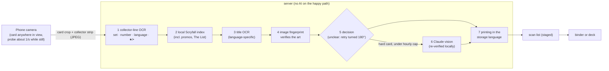

# Card scanner

How the **Scan** tab works: scanning, how cards are recognised, foil, double
scans, and tools for tuning.

- [Scanning](#scanning)
- [Tips for good scans](#tips-for-good-scans)
- [How a card is identified](#how-a-card-is-identified)
- [Foil](#foil)
- [Avoiding double scans](#avoiding-double-scans)
- [Scan list → binder or deck](#scan-list--binder-or-deck)
- [Record session](#record-session)
- [Scanner learning](#scanner-learning)
- [Calibration mode](#calibration-mode)
- [Limits](#limits)

The Scan tab turns a phone into a card scanner, in the style of ManaBox. It is
built to avoid ManaBox's two usual complaints: the same card being scanned
over and over, and confident wrong guesses. The camera needs HTTPS (see
[setup.md](setup.md#phones-and-https)), and the scanner needs its card index
(see [setup.md](setup.md#building-the-card-index)).

## Scanning

- Tap **Start camera** and put a card in view: on the table, in a scan box or in your
  hand. There is no guide frame to fill. A detector in the browser finds the
  card's outline and only supplies the crop; recognising the card is the
  server's job.
- While the card lies still, the app sends a quick **recognition probe**
  about once a second (the card crop from the full-resolution video frame plus
  its collector line). A card is staged as soon as it is **identified** and
  **differs from the last card** of this camera session; a probe that
  recognises nothing stores nothing. Swap in the next card and it is staged in
  turn. Probes never use Claude.
- For a **second copy** of the same card, tap **+1**.
- The **shutter** scans the current card on demand. When a card isn't
  recognised after a few tries, the hint reads *"Not recognised – tap to
  capture"*. Other hints: *"Reflection on the name: tilt slightly"* (also for
  the bottom line, the picture or the middle of the card) and *"Too blurry"*.
- **Ask Claude automatically for hard cards** (scan settings, on by default):
  a card that lies still and stays unrecognised gets one scan with Claude
  allowed, never twice for the same card. It counts towards
  `SCAN_CLAUDE_PER_HOUR`; at the cap the hint becomes *"Claude limit reached –
  tap to capture"*.
- On the camera the **last card** is shown with its status, set, number,
  language, finish (tap to switch) and € price, and top right the card's value
  plus the **session total** (Σ € · copies; `+` when some cards have no
  price).
- **Scan sounds:** a short sound for every staged card or +1, and a *cash*
  sound for cards worth at least the threshold (default €5). Both can be
  changed or turned off in the scan settings.
- **Discard** (trash) removes a wrong scan or something that is not a card,
  with a few seconds to undo. Scanning pauses while a sheet such as the
  printing picker is open.
- A card photographed **upside down** is retried turned by 180° when the first
  attempt is unclear.

## Tips for good scans

- Keep the card flat, without glare, and close enough that the collector line
  is legible.
- A dark scan box or table helps the detector; in good light without sleeves
  the results are best.

## How a card is identified

1. **Collector line.** The phone uploads a high-resolution crop of the
   bottom edge. Tesseract reads it on the server. Cards from M15 (2014) on
   print rarity, number, set code and language (`001/269 R / M15 • EN`, or
   `R 0001 / MOM • DE` from March of the Machine on). Set codes are matched
   with OCR-confusion weighting against the known sets.
2. **Local index.** The read is looked up in a local SQLite copy of Scryfall's
   `all_cards` bulk data, so there are no per-scan API calls. Promos,
   prerelease stamps and *The List* print their parent set's line, so those
   printings are candidates too and are offered through a "variant?" chip.
3. **Title.** The card name is OCR'd in the detected language and
   fuzzy-matched against printed names. Japanese titles are not read reliably;
   the collector line and the fingerprint still identify those cards.
4. **Fingerprint.** A perceptual hash of the whole card, the art box and the
   colours is compared against hashes of every Scryfall reference image. This
   confirms the art on modern cards. It is the main signal for cards printed
   1998–2014 (which carry only `123/249`, with no set or language) and the
   only one for pre-1998 cards, together with the title.
5. **Decision.** The result is **auto** (green, staged), **suggest** (yellow,
   staged, tap to confirm) or **review** (red, staged with the top candidates
   to pick from, and never committed until you pick). A low-confidence guess
   is never accepted silently. A probe stages only auto and suggest results.
   **Scanning on confirms a suggest card:** when the next card of the same
   camera session is staged, or you tap +1 on another card of it, the
   suggest card turns **✓ confirmed** (no extra tap). A next card with the
   same name doesn't count, since that may be the same card read as another
   printing. Undo of that next card (or +1) makes it a suggest card again.
6. **Claude (optional).** Only for a shutter scan or an automatic ask whose
   local result is uncertain, the card goes to Claude vision through the same
   Claude Code CLI and subscription token as the chat. The default model is
   Sonnet. Calls are capped per hour (`SCAN_CLAUDE_PER_HOUR`, default 60, `0`
   disables) and share the chat's concurrency limit. Claude's answer is never
   final: it must exist in the local index and be confirmed by local evidence,
   or it is dropped. When reference fingerprints exist, the claimed printing's
   art must match the photo and the fingerprint must not point to a different
   card; without a reference hash, the app's own collector or title OCR must
   back it. A verified Claude answer is at most **suggest** by default.
7. **Storage language.** By default (**Store as scanned**) a card is stored
   as the printing it is, in its own language: an Italian card stays Italian
   (names stay English, a small `IT` tag shows the language). You can pick a
   fixed storage language instead; then every scan is stored as the same set
   and collector number in that language, or in English when that printing
   doesn't exist, and the list shows both, for example `DE → EN`.

## Foil

- From M15 on, the collector line prints **★ for foil** and **• for
  non-foil**. The scanner measures that glyph's shape, because OCR can't read
  it. A later probe with a clear ★/• read corrects a finish that was only
  guessed.
- Printings that Scryfall lists with only one finish (for example foil-only
  promos, or etched-only cards) are set to that finish automatically.
- Older cards carry no foil marker. For those the sticky finish setting
  (Auto / Non-foil / Foil) decides. A guessed finish on a card that exists in
  both is marked with "?"; tap it on the camera or in the list to change it.

## Avoiding double scans

- Probes stage a card only when it differs from the **last card** of the
  camera session (same set, number and language; the finish doesn't count,
  because ★/• reads can vary). A card left in view, or put back, is not staged
  again, and neither is the card still lying there after a Discard or Undo.
  After a staged card the app waits until the card in view changes.
- Copies are counted on purpose with **+1**.
- A **shutter** scan of the same printing and finish right after itself
  (within `SCAN_DUPLICATE_WINDOW_MS`, 20 s by default) is not staged again;
  the app offers **+1** instead. A card that needs review is not staged twice
  either, and **Rescan** replaces its open review row.
- The big **Undo** button takes back the last action: the last scan, a +1,
  or an edit in the list (quantity, finish, printing).
- A ★ on a card that also exists as a foil-only promo with the same collector
  line (prerelease, promo pack) is only suggested, because the star can't
  tell the two apart; the **variant?** chip offers the promo.

## Scan list → binder or deck

Staged scans stay in the scan list until you add them somewhere. Tap
**Add all to…** (or select some first, then **Add selected to…**). Scans
marked for review must get a printing picked first:

- a **binder**: an existing one or a new one. The cards are added to the
  collection with source `scan`.
- a **deck**: an existing one or a new one with a format, on the board you
  choose (main, side, commander or maybe). Decks synced from ManaBox are not
  offered, because the next ManaBox import rebuilds them from the CSV.

You can also add cards by title search without the camera. Binders are
managed in the Collection tab (see [collection.md](collection.md#binders)).

**The scanner and ManaBox imports are separate.** Every collection row knows
where it came from (`manabox`, `scan` or `app`). A ManaBox *replace* import
only replaces rows that came from ManaBox, so scanned cards are never wiped by
a sync.

## Record session

**Record session** in the scan settings (off by default, stops after 15
minutes) stores a small, low-resolution frame every half second together with
the scanner's decisions in `DEBUG_SESSIONS_DIR` on the server. It is meant for
tuning the scanner or reproducing a problem. Recorded sessions are listed in
the scan settings and can be deleted there; a session is capped at 400 MB and
all sessions at 2 GB. Nothing is deleted automatically: when the storage is
full, recording stops with a notice until you delete old sessions. They are
not part of backups.

**Performance numbers.** While a Record session runs (or the page is opened
with `?scandebug=1`), the scanner also sends a small summary every 5 seconds to
`POST /api/debug/perf`: frame-analysis and probe timings, frame gaps, long
tasks, dropped frames, the granted camera size, whether the scan workers run,
where the camera frame is read (`frame_path`), the requested and delivered
camera size with the Android decision (`res`), and the phone's browser string, CPU core count, device
memory and pixel ratio. No images. Nothing is sent during normal scanning. The
server keeps the newest 500 entries (≤ 4 KB each) in `debug-perf.jsonl` next
to the database (env `DEBUG_PERF_FILE`); `GET /api/debug/perf?limit=` lists
them. Not part of backups.

**Where the camera frame is read.** The card finder looks at a small copy of
the camera picture (480 px on the short side), several times a second. On
desktop Chrome that copy comes from a second, invisible copy of the camera
feed that the browser delivers at that small size, so the page never has to
read the full 4K picture for it. The preview, the probe crops and the shutter
photo still use the full picture. The sharpness check uses the small copy too.
Each probe reads the full picture once for the card and its bottom strip
together. On Android the camera opens at 1440p (instead of 4K) and the small
copy is read from that picture: Android's invisible copy turned out to be a
cropped landscape view, and 1440p reads much faster than 4K while the bottom
strip stays wide enough (about 900-1000 px) for the ★/• and collector-number
reading. Safari and Firefox (and iPhones) keep 4K and read the small copy from
the picture on the page. The camera's resolution is never changed while you
scan, and the camera box keeps its size.

Test switches for a slow phone: `?scanworker=0` (no worker threads),
`?scanframes=auto|clone|main|track|bitmap` (where the small copy comes from;
default `auto` = `clone` on desktop Chrome, `main` on Android and elsewhere;
`clone` forces the invisible copy also on Android; `track` and `bitmap` read the
camera in the worker thread and are experiments only: on a Pixel 9 `track`
made the camera stall), `?scangrab=cpu|gpu|auto` (how the page reads it;
default `auto`) and `?scanres=1080|1440|4k` (the camera size; default 1440 on
Android, else 4k).
The perf beacon's `grab_mode` says which source ran (`path`, `why` when the
copy failed, `clone` with its size and `rot`, how far it was turned).

## Scanner learning

Every card whose printing gets settled is kept as a **labelled example**: the
scores and OCR reads of the scan together with the right printing and where
that answer came from (`source`):

| source | how |
| --- | --- |
| `implicit` | you scanned on past a suggest card |
| `user` | you tapped **Confirm**, or kept the printing in the picker |
| `correction` | you picked another printing |
| `calibration` | calibration mode's truth sheet |
| `commit` | the card went into a binder or deck as it was |

A commit updates the example to the card's final printing and finish. Only
calibration scans keep their photos after a commit; the other examples are
small text records.

**Settings → Scanner & data → Scanner learning** shows a short summary: how
many examples there are, how many unsure cards turned out right, how many you
fixed, how often a sure (auto) card was right, and the most common reason a
card stayed unsure. `GET /api/scans/learning` has the full numbers: counts by
source and outcome, which AUTO thresholds the confirmed suggest cards missed,
and per measure (title similarity, art distance, fingerprint distance and gap,
collector line confidence) a histogram of confirmed cards against wrongly
detected ones, plus the `relax` value: how far that one threshold could move
without letting a wrong detection through.

The scanner **never changes its thresholds on its own**. AUTO needs several
measures at once, so a `relax` value is only a candidate: with enough examples
(the report says when, about 30 confirmed unsure cards), try it with
`SCAN_THRESHOLDS` (see below) on a test install against your own recorded
sessions before using it for real. `GET /api/calibration/export` lists every
example with its `source` (`?source=implicit,correction` filters).

## Calibration mode

The default thresholds are deliberately **conservative**: they were tuned on
synthetic captures and favour asking you over guessing wrong. To tune them for
your own phone and cards:

1. Turn on **Calibration mode** in the scan settings. Then scan 30–50 of your
   own cards, a mix of eras, languages and foils.
2. After each scan, confirm or correct the true printing and finish. All
   scores and OCR outputs are recorded along with your answer.
3. Download **Export examples** (Settings tab, `GET /api/calibration/export`;
   `?source=calibration` for these scans only) and derive new values. Set them as JSON in `SCAN_THRESHOLDS`, for example
   `SCAN_THRESHOLDS={"fpAuto":0.27}`. Unknown keys are ignored with a warning.

## Limits

Some printings can't be told apart from a photo. Examples are prerelease and
promo-pack stamps, *The List* reprints, Alpha/Beta/Unlimited, and most
pre-2014 foils. For these the scanner picks the base printing and shows the
**variant?** chip so you can switch.
